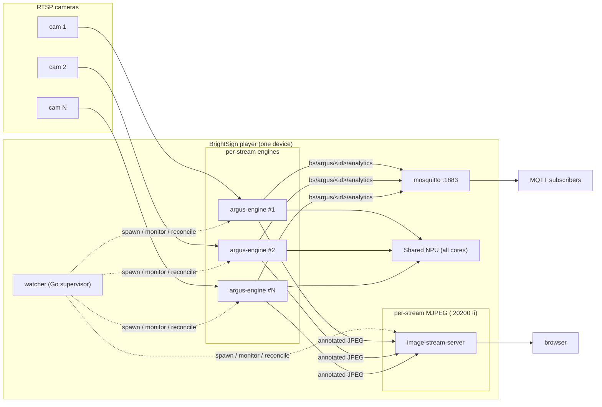
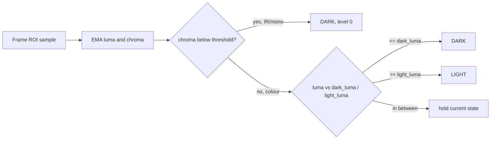

# Argus RTSP Watcher

Run real-time person and gaze analytics on **multiple RTSP camera feeds** from a single NPU-equipped BrightSign player.

## Try it Now!

Want to see it run before building anything? Grab the prebuilt extension, drop it on an SD card, and reboot the player — no toolchain, no cross-compile, no cache setup.

1. **Download the prebuilt extension** (`.bsfw`):

   ```sh
   curl -L -O https://github.com/brightsign/argus-rtsp-watcher/releases/download/v0.1.2/cobra-standalone-npu_watch-0.1.2.bsfw
   ```

   This is the **cobra-family** standalone build, v0.1.2 — it runs on any cobra-family player (XT5, XS6, HD6). See the [releases page](https://github.com/brightsign/argus-rtsp-watcher/releases) for other versions.

2. **Copy it to the root of an SD card:**

   ```sh
   cp cobra-standalone-npu_watch-0.1.2.bsfw /media/<you>/<SD-CARD>/
   ```

   A player applies a `.bsfw` from the SD-card root automatically on boot.

3. **Insert the card and reboot the player.** On boot it installs the extension and starts the watcher.

4. **Configure your camera(s).** The watcher needs a `config.json` telling it which streams to run — it won't analyze anything until you give it one. Create `/storage/sd/configs/config.json` listing your RTSP sources:

   ```json
   {
     "streams": [
       { "id": "lobby", "rtsp_url": "rtsp://192.0.2.10:8554/lobby", "target_fps": 10 }
     ]
   }
   ```

   The watcher hot-reloads it within a few seconds — no reboot needed to add, remove, or retune cameras. No camera handy? [Test without one](#testing-without-cameras). Full field reference is in [Configuration](#configuration).

5. **See it working.** Two ways:

   - **Browse to the on-player dashboard** at `http://<player-ip>:20300` — it lists your streams, shows each camera's live snapshot, and exposes controls (draw a detection [zone](#zones-regions-of-interest) and save it straight into the live config).
   - **Watch the analytics over MQTT:**

     ```sh
     mosquitto_sub -h <player-ip> -t 'bs/argus/#' -v
     ```

That's it — you're running multi-camera analytics on the NPU. The rest of this README covers [how to use it](#configuration) in depth and [how to build it yourself](#building).

> **Building this? Read [docs/PRE-REQS.md](docs/PRE-REQS.md) first.** The cross-compile
> SDK, RKNN toolkit, and compiled models come from a **shared build cache outside the
> repo** (`BS_CACHE_DIR`, default `../argus-build-cache`), provisioned once per box and
> reused across the sibling BrightSign NPU extensions. PRE-REQS covers populating that
> cache and pointing this repo at it; then `make package` builds everything.

## What it does

Argus RTSP Watcher turns one BrightSign player into a multi-camera audience-measurement node. Point it at several RTSP streams and it runs the [Argus](../argus-audience-measurement-extension) person + gaze pipeline on each one, on the player's Rockchip NPU, and publishes per-stream analytics over MQTT.

For every camera it reports, per person: a bounding box, whether they're looking at the display (gaze), dwell time, movement direction and speed, and entry/exit events — with stable per-person IDs across frames. It can also serve each stream as an annotated MJPEG video (boxes drawn on the frame) for a browser.

The design goal: several cameras, one player, no cloud. All inference runs on-device; no images leave the player unless you enable the preview server.

### Why it exists

The base Argus extension analyzes **one** camera per player. Many installs have several cameras covering one space but want one player doing the compute. The NPU already has the headroom — several streams at 5–10 fps fit within the inference budget of one stream at 30 fps, and on an XT5 that stretches to eight — so what was missing was a way to run and supervise N pipelines at once. That's this project.

## Key features

- **Multiple RTSP streams, one player** — configurable N (up to 8 on XT5).
- **Per-person analytics** — person box, gaze + gaze time, dwell, direction, speed, entry/exit, stable track IDs.
- **Per-stream MQTT** — `bs/argus/<stream-id>/analytics`, ~1 msg/s. See **[docs/bounding-boxes.md](docs/bounding-boxes.md)** for the box data.
- **Light/dark detection** — per-stream real-world light state (`LIGHT`/`DARK`/`UNKNOWN`), IR-aware, on `bs/argus/<stream-id>/light` and in the analytics message. See [Light/dark detection](#lightdark-detection).
- **Zones of interest** — draw a per-camera rectangle and each person reports `in_zone` (their feet inside it). Set it with `tools/zone-picker.sh`; see [Zones](#zones-regions-of-interest).
- **Browser preview** — optional annotated MJPEG per stream (boxes over the video).
- **Live reconfiguration** — edit `config.json` and streams are added/removed/retuned without restarting the others.
- **Fault isolation** — each stream is its own process group; one camera failing never touches the others; automatic restart with backoff.
- **Health endpoint** — `GET :9200/healthz` reports per-stream state and capacity.

## Architecture



The **watcher** is a small Go supervisor. It discovers `config.json`, renders one engine config per stream, starts one mosquitto broker plus one engine and one MJPEG preview server per stream, and supervises them all. The **engine** is a lean copy of the Argus person+gaze pipeline (YOLOX person detection + RetinaFace face/gaze + ByteTrack), one process per stream. See **[docs/DESIGN.md](docs/DESIGN.md)**.

## Supported hardware

| Player | SoC | NPU | Streams (person + gaze) |
|--------|-----|-----|-------------------------|
| **XT5** | RK3588 | 3-core, 6 TOPS | 8 @ 5–10 fps (primary target) |
| **XS6/XD6** | RK3576 | 2-core, 4 TOPS | 4 @ 5–10 fps |
| **LS5 / HS5** | RK3568 | 1-core, 1 TOPS | 1 stream (multi-stream not supported at target fps) |

Configuring more streams than a tier's capacity is a startup warning, not a failure.

## Prerequisites

- **A player**: an NPU-equipped BrightSign player (RK3588/RK3576/RK3568) with SSH enabled.
- **RTSP sources** reachable from the player, carrying **plain RTSP** H.264/H.265. Cameras that only offer secure RTSP (`rtsps://` / SRTP, e.g. UniFi Protect) must be fronted by an RTSP proxy — see [RTSP sources & MediaMTX](#rtsp-sources--mediamtx). To test with **no cameras at all**, serve looped video files as RTSP with the harness in [test/rtsp-sim/](test/rtsp-sim/).
- **To build**: an x86_64 Linux host with Docker (for RKNN model compilation), Go 1.22+, `git`, network access, and the BrightSign aarch64 cross-compile SDK. All runtime assets are built on the host from pinned upstream sources; you cannot build on the player. See **[docs/PRE-REQS.md](docs/PRE-REQS.md)** for one-time SDK + shared-cache setup, and [Building](#building) for the per-asset breakdown.

## Quick start

1. **Write `config.json`** listing your streams:

   ```json
   {
     "streams": [
       { "id": "lobby",      "rtsp_url": "rtsp://192.0.2.10:8554/lobby",      "target_fps": 10 },
       { "id": "entrance", "rtsp_url": "rtsp://192.0.2.10:8554/entrance", "target_fps": 10 },
       { "id": "aisle",   "rtsp_url": "rtsp://192.0.2.10:8554/aisle",   "target_fps": 5  }
     ]
   }
   ```

2. **Put it on the player's SD card** at `/storage/sd/configs/config.json`. It wins the config-discovery order, so no rebuild needed to change cameras.

3. **Install the extension** (see [Deploying to a player](#deploying-to-a-player)) and reboot.

4. **Watch the data**:

   ```sh
   mosquitto_sub -h <player-ip> -t 'bs/argus/#' -v
   ```

   You should see one message per second per stream on `bs/argus/lobby/analytics`, `.../entrance/analytics`, `.../aisle/analytics`.

5. **(Optional) Mark a zone** to learn when someone is standing in a specific area — see [Zones](#zones-regions-of-interest).

## Configuration

### `config.json`

The single operator-facing file, with three top-level sections — `streams` (required), `mediamtx` (optional), and `engine` (optional). Strict parsing: no comments, no unknown keys.

| Field | Required | Notes |
|-------|----------|-------|
| `streams` | yes | The list of cameras to run, one engine each (fields below). |
| `mediamtx` | no | `{ "enabled": bool, "config": "<path>" }` — run the bundled on-player RTSPS proxy. Default off. See [Running the proxy on the player](#running-the-proxy-on-the-player-optional). |
| `engine` | no | The per-stream engine template (models, thresholds, MQTT, logging). Omit to inherit the packaged default; include to override it. Rendered per stream, with `confidence`/`zone`/`target_fps`/`rtsp_url` applied on top. |
| `streams[].id` | yes | Unique, `^[A-Za-z0-9_-]+$`. Becomes the MQTT topic and preview port index. |
| `streams[].rtsp_url` | source* | The camera/proxy RTSP URL. |
| `streams[].file_path` | source* | A local video file to analyze instead of a live feed (test/offline). |
| `streams[].usb` | source* | `true` to capture from the player's local USB camera. The device is auto-detected. |
| `streams[].usb_width` | no | USB capture width in pixels. Only with `usb: true`; omit for the engine default. |
| `streams[].usb_height` | no | USB capture height in pixels. Only with `usb: true`; omit for the engine default. |
| `streams[].usb_fps` | no | USB capture frame rate. Only with `usb: true`; omit for the engine default. |
| `streams[].target_fps` | no | Default `10`; intended range 5–10. Caps NPU load. |
| `streams[].confidence` | no | Person-detection threshold, `0.0`–`1.0`. Omit for the engine default (`0.5`). See [Detection confidence](#detection-confidence). |
| `streams[].zone` | no | Custom "important area" as `[x0,y0,x1,y1]`, normalized 0..1. When set, each track reports `in_zone`. Draw it with the on-player dashboard (`:20300`) or `tools/zone-picker.html`. |
| `streams[].light` | no | Light/dark detection settings (`enabled`, `interval_seconds`, thresholds, ...). Defaults apply to omitted fields. See [Light/dark detection](#lightdark-detection). |
| `streams[].zone_mode` | no | How a box is tested against the zone: `any` (default) — any part of the box overlapping the zone counts; `base` — only when the box's feet (bottom-centre) are inside. |

*Each stream names exactly one source: `rtsp_url`, `file_path`, or `usb`.

### Choosing a source

Every stream has exactly one input. Pick the one that matches where the video comes from:

```json
{
  "streams": [
    { "id": "porch",  "rtsp_url": "rtsp://192.0.2.10:8554/porch", "target_fps": 10 },
    { "id": "sample", "file_path": "/storage/sd/clips/lobby.mp4",     "target_fps": 10 },
    { "id": "local",  "usb": true, "usb_width": 1280, "usb_height": 720, "usb_fps": 30, "target_fps": 10 }
  ]
}
```

- **`rtsp_url`** — a live camera or an RTSP proxy (the normal case).
- **`file_path`** — a video file on the player, for offline runs and accuracy testing.
- **`usb`** — the player's attached USB camera. The engine auto-detects the device node, so you do not name it. The `usb_width`/`usb_height`/`usb_fps` keys are optional overrides for how the camera is opened; leave them out to let the engine choose. Setting any `usb_*` key without `usb: true` is a config error.

### Detection confidence

`confidence` sets how sure the detector must be before it reports a person, from `0.0` (accept everything) to `1.0` (accept nothing). It defaults to the engine's built-in `0.5`. Lower it to catch more distant or partially-occluded people at the cost of more false positives; raise it to suppress spurious boxes in a busy scene. It is per stream, so a hard camera can run looser than a clean one:

```json
{
  "streams": [
    { "id": "far-lot", "rtsp_url": "rtsp://192.0.2.10:8554/far-lot", "confidence": 0.35 },
    { "id": "lobby",   "rtsp_url": "rtsp://192.0.2.10:8554/lobby",   "confidence": 0.6  }
  ]
}
```

### Discovery order

The watcher looks for `config.json` in this order, first found wins (no CLI/env override):

1. `/storage/sd/configs/config.json`  ← standard location
2. `/storage/sd/config.json`
3. `/storage/ssd/configs/config.json`
4. `/storage/ssd/config.json`
5. the packaged default inside the extension

See **[examples/](examples/)** for ready-to-copy `config.json` files (basic,
USB, and a multi-stream feature showcase).

### Zone dashboard (on the player)

The extension runs an on-player **zone dashboard** at `http://<player>:20300`
(the bundled `config-server`, supervised by the watcher). It lists your streams,
shows each camera's live snapshot, and lets you **draw a detection zone** on it
and **Save** — the write lands in the live `config.json`, which hot-reloads within
a few seconds (no reboot). The zone then shows as a faint green outline on that
camera's annotated feed. (`tools/zone-picker.html` remains as an offline host-side
picker that exports zone coordinates to paste by hand.)

## RTSP sources & MediaMTX

The engine consumes **plain RTSP** carrying **H.264 or H.265**. Point each
stream's `rtsp_url` at a camera or an RTSP proxy. Other codecs (e.g. VP9) must be
transcoded to H.264 first.

### Why a proxy is often required

BrightSign players **do not yet support secure RTSP** — `rtsps://` with SRTP
encryption. Several camera systems only expose their streams that way, so the
player cannot open them directly:

- **UniFi Protect** serves `rtsps://<nvr>:7441/<token>?enableSrtp` (SRTP-encrypted).
- Other cameras send non-standard RTP packetization that needs normalizing, only
  publish on demand, or you simply want one upstream pull fanned out to several
  readers.

The fix is a small **RTSP proxy** — [MediaMTX](https://github.com/bluenviron/mediamtx) —
on an always-on LAN host (a mini PC, NUC, or Pi). It pulls from each camera and
re-publishes a **plain `rtsp://`** stream the player can read. Your `config.json`
then points at the proxy, not the camera.

```
 UniFi / SRTP cameras ──rtsps(7441)──▶  MediaMTX proxy  ──rtsp(8554)──▶  BrightSign player
                                        (converts to plain RTSP)
```

### Configuring MediaMTX (UniFi Protect example)

`mediamtx.yml` on the proxy host:

```yaml
rtsp: yes
rtspAddress: :8554
rtmp: no
hls: no
webrtc: no
srt: no

paths:
  entrance:
    # UniFi Protect serves the SAME stream token as PLAIN RTSP on port 7447.
    # Use 7447 -- NOT the rtsps/SRTP variant on 7441 (?enableSrtp): the player
    # can't decrypt SRTP, and that variant also garbles through MediaMTX
    # (STAP-B / AU-index RTP errors). The token comes from the Protect UI:
    # camera -> Settings -> Advanced -> enable RTSP.
    source: rtsp://<nvr-ip>:7447/<camera-token>
    sourceOnDemand: no    # keep warm so the player gets its first frame quickly
    rtspTransport: tcp    # UniFi's oversized RTP packets get truncated over UDP
```

Run it with podman (or docker):

```sh
podman run -d --name mediamtx --network host \
  -v ./mediamtx.yml:/mediamtx.yml:ro bluenviron/mediamtx:latest
```

Then set `"rtsp_url": "rtsp://<proxy-ip>:8554/entrance"` in `config.json`
(see `examples/config-advanced.example.json`).

> **Key points:** use port **7447** (plain RTSP), never 7441 (`rtsps`/SRTP); pull
> over **TCP**; and keep `sourceOnDemand: no` so the stream stays warm and the
> engine's first-frame wait doesn't time out.

### Running the proxy on the player (optional)

Instead of a separate LAN host, the extension can run MediaMTX **on the player
itself**, supervised by the watcher (crash-restarted, cleanly stopped). It's
**opt-in** — off by default. Enable it in `config.json`:

```json
{
  "streams": [
    { "id": "entrance", "rtsp_url": "rtsp://localhost:8554/entrance", "target_fps": 10 }
  ],
  "mediamtx": { "enabled": true }
}
```

MediaMTX reads its config first-found from:

```
/storage/sd/configs/mediamtx.yml      # operator override (survives reinstall)
/storage/sd/mediamtx.yml
<extension dir>/mediamtx.yml           # packaged default (placeholders)
```

Put your `paths:` (the same `mediamtx.yml` shown above) in
`/storage/sd/configs/mediamtx.yml`, point each `config.json` stream at
`rtsp://localhost:8554/<path>`, and reboot or `bsext_init restart`. The
port-7447-vs-7441 guidance above still applies. See
[docs/mediamtx-secure-rtsp.md](docs/mediamtx-secure-rtsp.md) for the TLS details.

> On-player proxying uses the player's CPU/RAM; for many streams a dedicated LAN
> host is still the better choice. Measure before committing to it in production.

### Testing without cameras

Serve looped video files as RTSP with the bundled harnesses — no proxy or
cameras needed:

- [test/rtsp-sim/](test/rtsp-sim/) — several looped clips as separate cameras.
- [test/loop-stream/](test/loop-stream/) — one clip on N channels, used by the
  accuracy test that checks all channels report the same results.

## Outputs

### MQTT (primary)

Broker on the player, port `1883`, anonymous. One topic per stream: `bs/argus/<id>/analytics`, schema `analytics/v7.1` (additive over v7.0), ~1 msg/s. The per-person bounding boxes and gaze boxes are in the `tracks[]` array. A second topic, `bs/argus/<id>/light`, carries the scene light state — see [Light/dark detection](#lightdark-detection).

When a stream has a `zone` configured, each track also carries an `in_zone` boolean — see [Zones](#zones-regions-of-interest).

**→ Full detail, schema, coordinate system, and code examples: [docs/bounding-boxes.md](docs/bounding-boxes.md).**

#### Consuming the feeds

Any MQTT client works. The repo also ships a minimal example client that prints each message's JSON (one per line, connection logs on stderr), so you can pipe it to `jq`:

```sh
# raw JSON from every feed
mosquitto_sub -h <player-ip> -t 'bs/argus/#'

# bundled example client -> jq
make -C example-client build
example-client/bin/argus-example-client --broker <player-ip>:1883 | jq .

# only messages where someone is in a zone
example-client/bin/argus-example-client --broker <player-ip>:1883 \
  | jq -c 'select(any(.tracks[]?; .in_zone == true))'
```

### Light/dark detection

Each stream reports whether the scene is really light or dark. It is IR-aware: a monochrome night image from an IR-illuminated camera (near-zero chroma) is reported `DARK` even though the pixels are bright. In colour mode the decision uses smoothed luminance with hysteresis (a dead-band between `dark_luma` and `light_luma`) and a minimum dwell time so the state does not flap. Set `monochrome_camera: true` for feeds that are always grayscale; that skips the chroma rule and decides on luminance alone, which is less robust against IR illuminators.



**Light topic.** `bs/argus/<id>/light` is published every `interval_seconds` (default 10) with `event: "periodic"`, and immediately on a state change with `event: "change"` (when `on_change` is true). It is published **retained** (`retain: true`) at **QoS 1**, unlike the analytics topic, which is not retained by default, because it is a state topic: a subscriber that connects between heartbeats gets the current state at once.

```json
{
  "device_id": "cam1",
  "state": "DARK",
  "level": 0,
  "ir_mode": true,
  "luma": 182.4,
  "chroma": 2.1,
  "event": "periodic",
  "ts_ms": 1746732409123
}
```

| Field | Meaning |
|-------|---------|
| `state` | `LIGHT`, `DARK`, or `UNKNOWN` (during warm-up). |
| `level` | Real-world light, `0`..`100`. Always `0` in IR mode. |
| `ir_mode` | `true` when the feed is a monochrome/IR night image. |
| `luma`, `chroma` | Smoothed luminance and chroma, for tuning thresholds. |
| `event` | `periodic` or `change`. |

**Analytics message (schema `analytics/v7.1`).** When light detection is enabled the analytics message gains a scene-level `"light": {"state","level","ir_mode","luma","chroma"}` object and each track gains a `"light": "<STATE>"` field. Both are omitted when detection is disabled, so v7.0 consumers keep working.

**Configuration.** Add an optional `light` object to a stream in `config.json`. Every field is optional; omitted fields take the defaults below.

| Field | Default | Notes |
|-------|---------|-------|
| `enabled` | `true` | Run light detection for this stream. |
| `interval_seconds` | `10` | Periodic publish period on the light topic. |
| `on_change` | `true` | Also publish immediately on a state transition. |
| `dark_luma` | `40` | Smoothed luma at or below this means `DARK` (colour mode). |
| `light_luma` | `70` | Smoothed luma at or above this means `LIGHT` (colour mode). Must be `>= dark_luma`. |
| `chroma_threshold` | `10` | Smoothed chroma below this means IR/monochrome, reported `DARK`. |
| `ema_alpha` | `0.1` | Per-frame smoothing factor. |
| `min_dwell_seconds` | `5` | Minimum time in a state before it may flip. |
| `warmup_seconds` | `3` | State is `UNKNOWN` until this much data is gathered. |
| `roi_frac` | `0.6` | Central fraction of the frame that is sampled. |
| `sample_stride` | `8` | Minimum pixel sampling stride. |
| `monochrome_camera` | `false` | Always-grayscale feed: skip the chroma rule, luminance only. |

```json
{ "id": "cam1", "rtsp_url": "rtsp://192.0.2.101:554/stream1", "light": { "enabled": true, "interval_seconds": 10 } }
```

Design detail: [docs/superpowers/specs/2026-10-24-light-dark-detection-design.md](docs/superpowers/specs/2026-10-24-light-dark-detection-design.md).

### Browser preview (optional, on by default)

Each stream is served as annotated MJPEG (boxes drawn on the video) at:

```
http://<player-ip>:<port>/      port = 20200 + the stream's 0-based index in config.json
```

So the example config above gives `lobby` → `:20200`, `entrance` → `:20201`, `aisle` → `:20202`. The player must allow inbound on those ports. Annotated frames are written on-device to `/tmp/argus-frames/<id>/output.jpg`.

### Health

```sh
curl -s http://<player-ip>:9200/healthz
```

Returns the detected SoC/tier, configured vs. safe stream count, and each stream's state (`running` / `restarting` / `failed`) with restart counts.

## Zones (regions of interest)

Mark a rectangle on a camera and Argus tells you when a person is standing in it. It is additive **labeling, not a gate**: every message is still published; each track simply gains an `in_zone` boolean.

- **Match mode (`zone_mode`):** `any` (default) — any part of a person's box overlapping the rectangle counts; or `base` — only when their **feet** (bounding-box bottom-centre) are inside. Set per stream.
- **Inside rule:** a track reports `in_zone: true` when it satisfies the stream's match mode, otherwise `false`. It's per person, so two people in the same message can differ.
- **Coordinates:** normalized `0..1` fractions of the frame, `[x0, y0, x1, y1]` — resolution-independent.
- A stream with **no** `zone` emits no `in_zone` field at all.

**Set a zone:**

1. Draw it on the live camera and copy the coordinates:

   ```sh
   tools/zone-picker.sh --player <player-ip> --port <20200+index>
   ```

   Drag a rectangle over the area; copy the `"zone": [..]` line it prints. (No script? Open `tools/zone-picker.html` in a browser and load a frame or `http://<player>:<port>/image`.)

2. Add it to that stream in `config.json`:

   ```json
   { "id": "entrance", "rtsp_url": "rtsp://.../entrance", "target_fps": 10, "zone": [0.40, 0.53, 0.90, 1.00] }
   ```

3. Save it to `/storage/sd/configs/config.json`. That one camera's engine restarts (a few seconds) and its tracks start reporting `in_zone`; the other cameras are untouched.

**Act only when someone is in a zone** — filter client-side (nothing is suppressed on the player):

```sh
mosquitto_sub -h <player-ip> -t 'bs/argus/#' \
  | jq -c 'select(any(.tracks[]?; .in_zone == true))'
```

## Tools (host-side)

Helpers in `tools/` (their own Go module + scripts). Build the binaries with `make -C tools build`; full detail in **[tools/README.md](tools/README.md)** and **[docs/recording-and-sync.md](docs/recording-and-sync.md)**.

| Tool | What it does |
|------|--------------|
| `tools/zone-picker.sh` / `zone-picker.html` | Draw a zone on a live or recorded frame; outputs the normalized `zone` for `config.json` and pixel coords for `boxstats`. |
| `tools/record-frames.sh` | Record a stream's annotated frames **and** its MQTT box data together, in sync. |
| `tools/bin/framebox` | Given a recorded frame, decode its `frame_seq` stamp and print the boxes recorded for that exact frame. |
| `tools/bin/boxstats` | Report the range of person-box areas inside a region across a recording (helps pick a size/zone filter). |

## Building

All build and test go through the Makefile (run `make` with no target to list them):

```sh
make            # list targets
make run-tests  # Go unit tests + engine (C++) unit tests
make build      # cross-compile watcher + engine for all SoCs and produce the extension zips
```

`make build` produces two packages in the repo root:

- `argus-rtsp-watcher-ext-<ts>.zip` — the LVM **extension** (install this on a player).
- `argus-rtsp-watcher-<ts>.zip` — a dev bundle you unzip and run directly.

### First-time setup (once per build box)

The heavy, box-level assets — the cross-compile **SDK**, the **RKNN toolkit**, and the compiled **models** — are **not** built in this repo. They live in a **shared build cache outside the repo** (`sdk/`, `toolkit/`, `models/`), built **once per build box** and reused by every BrightSign NPU project. The first-time flow is: **(1)** build the SDK into the cache, **(2)** compile the models into the cache, **(3)** point this repo at the cache, then **(4)** build. See **[docs/PRE-REQS.md](docs/PRE-REQS.md)** for the full version with a diagram, supported targets, and troubleshooting.

#### Step 1 — Download and compile the SDK into the cache

The SDK is produced by the sibling [`brightsign-sdk-builder`](https://github.com/brightsign/brightsign-sdk-builder) repo, which downloads the BrightSign OS source and cross-compiles the cobra toolchain straight into the shared cache. Check it out **parallel** to this repo and build it:

```bash
cd ..
git clone https://github.com/brightsign/brightsign-sdk-builder.git
cd brightsign-sdk-builder
make build        # downloads OS source, builds the SDK into ../argus-build-cache/sdk (network + ~25 GB; HOURS)
```

This fills `../argus-build-cache/sdk/` (the default cache location, parallel to both repos).

> **Or let this repo do it for you.** If the cache is configured but has no SDK, `make build` in **this** repo auto-runs the builder (it is a `fetch-sdk` dependency). Disable the auto-build with `AUTO_BUILD_SDK=0`, or install a prebuilt `brightsign-x86_64-cobra-toolchain-*.sh` with `make fetch-sdk SDK_INSTALLER=/path/to/installer.sh`. Either way the SDK is a one-time, hours-long build. See [docs/PRE-REQS.md § Phase 1](docs/PRE-REQS.md#phase-1--populate-the-shared-cache-one-time-per-box).

#### Step 2 — Compile the RKNN models into the cache (needs Docker)

```bash
# in this repo
make build-models   # compiles RetinaFace + YOLOX per SoC into ../argus-build-cache/models/<SOC>/
```

Needs Docker + ~10 GB + network; idempotent once the models are present. `make build` runs this automatically as a dependency, but you can pre-stage it here.

#### Step 3 — Configure this repo to point at the cache

If this repo is checked out parallel to `brightsign-sdk-builder`, the default cache (`../argus-build-cache`) resolves automatically and this step is optional. Otherwise, tell the repo where the cache lives:

```bash
cp cache.env.example cache.env
# edit cache.env:  BS_CACHE_DIR := /abs/path/to/argus-build-cache
make cache-info     # show the resolved cache and whether sdk / toolkit / models are present
```

`cache.env` is git-ignored. A command-line override always wins: `make build BS_CACHE_DIR=/path/to/argus-build-cache`.

#### Step 4 — Build the packages

```bash
make build          # == make package: cross-compile all SoCs, sync models from the cache, emit the zips
```

`make build` (an alias for `make package`) depends on `fetch-sdk` + `build-models`, so a missing SDK or models is provisioned automatically — or the build stops with an actionable message. It produces the two zips described above. Host-only `make run-tests` needs no SDK.

### Build-time assets (self-contained)

The repo has **no dependency on a sibling Argus tree**. Every runtime asset is produced on demand from pinned upstream sources on the first `make build` and cached under gitignored `build/` (re-runs skip what's already built):

| Target | Produces | Needs |
|--------|----------|-------|
| `make prep` | the Rockchip RKNN API headers + `librknnrt.so` into `engine/include/` | network |
| `make fetch-sdk` | installs the aarch64 cross-compile SDK into `./sdk` | the cobra toolchain installer — see below |
| `make build-engine` | the C++ engine (aarch64) | the cross-compile SDK — see below |
| `make build-mosquitto` | the mosquitto broker (from source) + client tools | SDK |
| `make build-libs` | the runtime `lib/` tree (OpenCV/GStreamer/RGA/RKNN/TurboJPEG), harvested from the SDK sysroot | SDK |
| `make build-models` | `RetinaFace.rknn` + `yolox_s.rknn` per SoC + coco labels, compiled from upstream ONNX | **Docker** + ~10GB + network |
| `make build-image-server` | the MJPEG preview server (from its upstream repo) | `git` + `go` + network |

The **RKNN headers and runtime** are not vendored: the Rockchip RKNN API headers and `librknnrt.so` are fetched from the pinned upstream (`airockchip/rknn-toolkit2` `v2.3.0`) by `make prep` into `engine/include/` (a prerequisite of the engine build), so no Rockchip-proprietary bytes live in this repo.

The **cross-compile SDK**, the **RKNN toolkit clone**, and the **compiled models** live in a **shared build cache outside the repo** (default `../argus-build-cache`, parallel to this checkout; override with `BS_CACHE_DIR` in `cache.env` — see [`cache.env.example`](cache.env.example)), so they are produced once and reused across sibling projects. Run `make cache-info` to see the resolved location and what is present. Full one-time setup is in **[docs/PRE-REQS.md](docs/PRE-REQS.md)**.

### Resetting the build

`make clean` returns this checkout to a freshly-cloned state (removes `build/`, `staging/`, zips, and the fetched prep headers) while leaving the shared cache intact. `make cache-clean` removes the shared cache itself — for **all** projects — forcing the hours-long SDK rebuild in [Step 1](#step-1--download-and-compile-the-sdk-into-the-cache) next time.

## Deploying to a player

### Copy the zip with `make copy`

Set the target player once in a local `.envrc` (gitignored — it holds a password):

```sh
cp envrc-example .envrc
$EDITOR .envrc          # set BS_PLAYER (host/ip) and BS_PASSWORD (SSH password)
direnv allow            # or without direnv:  set -a; . ./.envrc; set +a
```

Then push the most recently built zip to the player's SD card:

```sh
make copy               # scp's the newest *.zip to /storage/sd/ on $BS_PLAYER
make copy ZIP=argus-rtsp-watcher-ext-<ts>.zip   # or target a specific zip
```

`make copy` needs `sshpass` on your host (`sudo apt install sshpass`) and connects as
user `brightsign`. It copies **two** files to `/storage/sd/`: the zip and
`install-on-player.sh` — a helper regenerated by every `make package` that embeds
this build's exact zip name (so it installs the right one even though `/storage/sd`
accumulates old zips).

### Install on the player

SSH in, descend to the root Linux shell, and run the copied helper:

```sh
# descend from the SSH session: Ctrl-C, Enter -> exit -> exit  (dev/insecure player)
sh /storage/sd/install-on-player.sh
```

The helper runs the manual steps for you — `cd /usr/local`, `unzip` this build's zip,
`bash ./ext_npu_watch_install-lvm.sh` — then prunes older
`argus-rtsp-watcher-ext-*.zip` files from `/storage/sd` (keeping only the one it just
installed). **On success it reboots the player automatically; on failure it leaves you
in the shell** (no reboot) so you can inspect the error. (Equivalent manual form if you prefer:
`cd /usr/local && unzip -o /storage/sd/argus-rtsp-watcher-ext-<ts>.zip && bash ./ext_npu_watch_install-lvm.sh`.)

Extension lifecycle on the player (root shell): `/var/volatile/bsext/ext_npu_watch/bsext_init {start|stop|restart|status}`. The watcher owns mosquitto and all engine + preview processes; `bsext_init` only manages the single watcher. See **[docs/HARDWARE-VALIDATION.md](docs/HARDWARE-VALIDATION.md)** for the on-device checklist.

## Project structure

```
cmd/watcher/        Go supervisor entry point
internal/
  config/           config.json load + discovery + validation
  configgen/        render per-stream engine config from the template
  platform/         SoC detection + capacity tiers
  supervisor/       process lifecycle, backoff, live reconcile
  configwatch/      config.json change detection
  broker/           mosquitto start + readiness
  health/           /healthz
engine/             lean C++ person+gaze engine (copied/adapted from Argus)
packaging/          bsext_init + make-extension-lvm
configs/            config.json (per-stream engine config template)
examples/           example config.json configs (the default baked into the extension lives here)
scripts/            build.sh, fetch-sdk.sh
tools/              host tools: zone-picker(.sh/.html), record-frames.sh, framebox, boxstats
example-client/     minimal MQTT client that prints each message's JSON
test/               rtsp-sim (multi-cam sim) + loop-stream (accuracy test harness)
docs/               DESIGN.md, bounding-boxes.md, recording-and-sync.md, HARDWARE-VALIDATION.md
```

## Troubleshooting

| Symptom | Check |
|---------|-------|
| No MQTT messages | Is an engine running? `curl :9200/healthz` — if `Restarts` keeps climbing, the engine can't open its RTSP stream. |
| Engines crash-loop, `first-frame timeout` in `/tmp/watcher.log` | The RTSP source is slow to deliver the first frame. Keep the source warm (e.g. MediaMTX `sourceOnDemand: no`) and confirm the player can reach the URL. The engine allows up to 15s for the first frame. |
| Preview page loads but shows a placeholder box | The engine isn't writing frames (usually the same RTSP problem above) — fix the engine first; the preview serves whatever is at `/tmp/argus-frames/<id>/output.jpg`. |
| `over_capacity: true` in health | More streams than the SoC tier supports (see the hardware table). |
| Player unreachable on preview ports | Open inbound `20200..20200+N-1`. |

Logs: `tail -f /tmp/watcher.log` on the player (engine + watcher output).

## Documentation

- **[docs/PRE-REQS.md](docs/PRE-REQS.md)** — SDK, shared build cache, and `cache.env` setup; read before building.
- **[docs/bounding-boxes.md](docs/bounding-boxes.md)** — live bounding-box data over MQTT (schema, coordinates, examples).
- **[docs/recording-and-sync.md](docs/recording-and-sync.md)** — record the MJPEG streams and match them to the box data by frame.
- **[tools/README.md](tools/README.md)** — host tools: zone picker, recorder, framebox, boxstats.
- **[test/rtsp-sim/README.md](test/rtsp-sim/README.md)** — serve looped video files as RTSP to test without live cameras.
- **[docs/DESIGN.md](docs/DESIGN.md)** — architecture and design decisions.
- **[docs/HARDWARE-VALIDATION.md](docs/HARDWARE-VALIDATION.md)** — on-device validation checklist.
- **[VISION.md](VISION.md)** — what and why.

## License

The original work in this repository is licensed under the **Apache License,
Version 2.0** — see [LICENSE](LICENSE) and [NOTICE](NOTICE). That covers the Go
supervisor (`cmd/`, `internal/`), the build and packaging scripts, the tools,
and the documentation.

This project also **collects together and packages a number of independently
licensed third-party components, which retain their own licenses.** The
Apache-2.0 grant does not relicense them. In particular:

- The analytics engine under `engine/` is **derived from the BrightSign Argus
  Audience Measurement Extension** and carries its upstream license.
- The **Rockchip RKNN** runtime and headers are proprietary to Rockchip and are
  redistributed under Rockchip's own terms.
- Bundled runtime libraries — **Eclipse Mosquitto, MediaMTX, FFmpeg, GStreamer,
  OpenCV, OpenSSL**, and others — each remain under their respective licenses.

See **[THIRD-PARTY-NOTICES.md](THIRD-PARTY-NOTICES.md)** for the full inventory.
