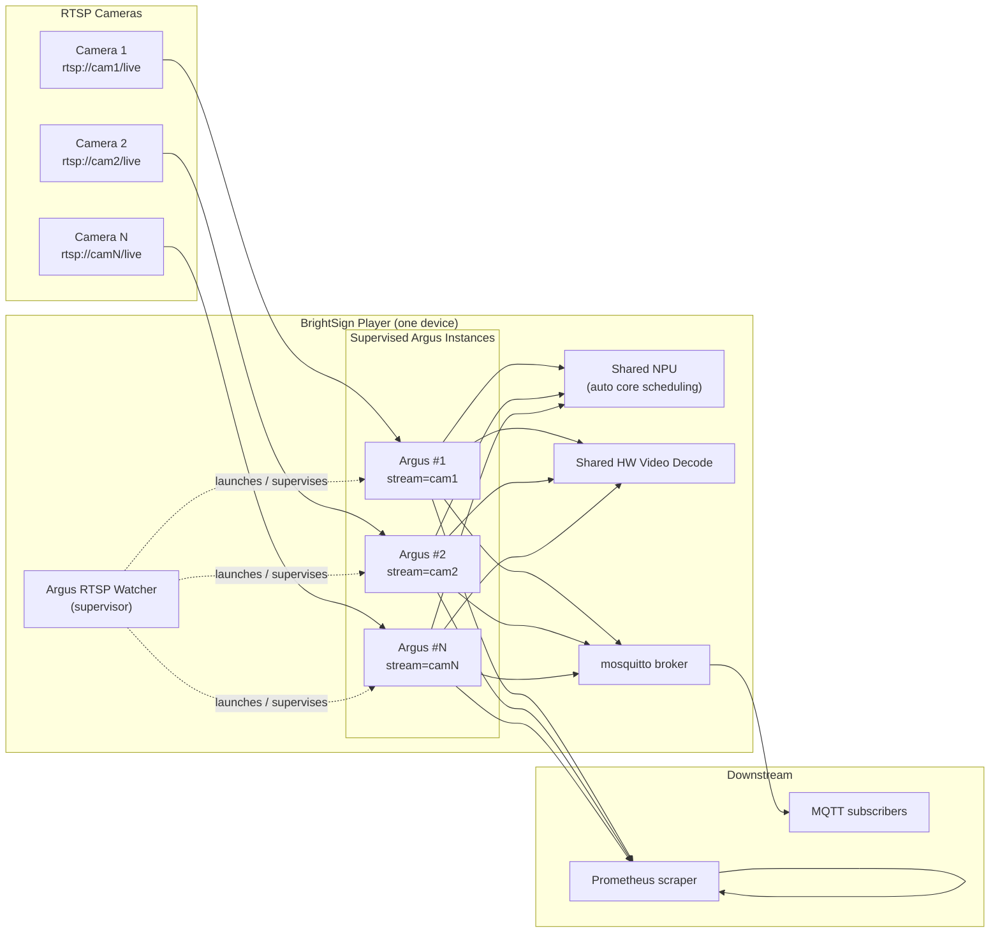
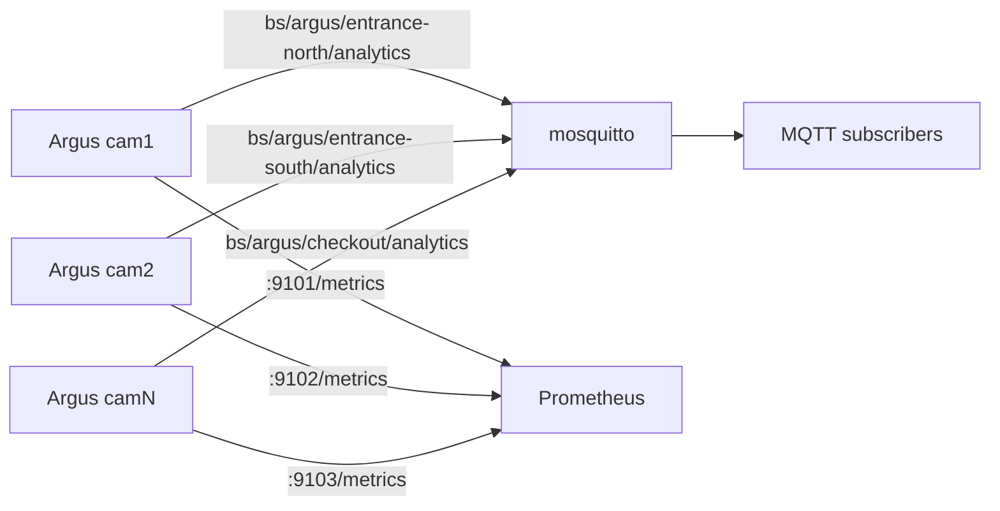

# Argus RTSP Watcher — Vision

**Run Argus audience analytics on multiple RTSP camera feeds from a single BrightSign player.**

Argus RTSP Watcher turns one NPU-equipped BrightSign player into a multi-camera
audience-measurement node. It supervises several independent Argus analytics
pipelines — one per RTSP stream — that share the player's NPU, video decoder, and
network, and it publishes per-stream analytics exactly as a single-camera Argus
deployment does today.

---

## 1. Why We Are Building This

The existing [Argus Audience Measurement Extension](../argus-audience-measurement-extension)
analyzes **one** video source (USB webcam or a single RTSP stream) per player. It
detects people, tracks them, and determines gaze, publishing analytics over MQTT
and Prometheus.

Many real deployments have **several cameras** covering one space — multiple
doorways, multiple aisles, multiple displays — but only want **one player** doing
the compute. Buying and mounting one player per camera is expensive and
operationally heavy.

The NPU headroom already exists. A single Argus stream at 30 fps runs two NPU
inferences per frame (≈60 inferences/second). Three streams at 10 fps each is the
**same** total inference rate. The hardware can already do the work; what is
missing is a way to run and manage **N pipelines at once** on one device.

Argus RTSP Watcher fills that gap.

---

## 2. What We Are Building

A **native BrightSign extension** that acts as a **supervisor** for multiple Argus
analytics processes. It does not reimplement detection, tracking, or gaze logic —
it **reuses the proven Argus engine binary** and runs one instance of it per RTSP
stream, coordinating their startup, configuration, NPU sharing, health, and
lifecycle.

Each supervised instance:

- Connects to one RTSP camera.
- Runs person detection (YOLOX) and face/gaze detection (RetinaFace) on the
  shared NPU.
- Tracks individuals (ByteTrack) and computes the full Argus analytics set.
- Publishes its own analytics stream, namespaced so downstream consumers can tell
  the cameras apart.

The Watcher owns everything **around** those instances: reading a multi-stream
configuration, launching and pinning each instance, throttling capture frame
rate, assigning output identities and ports, restarting failed instances, and
reporting overall health.



---

## 3. Goals

- **Multiple RTSP feeds, one player.** Run analytics on several RTSP cameras
  concurrently on a single NPU-equipped BrightSign player.
- **Configurable stream count (N).** The number of streams is driven by
  configuration, not hard-coded. The system is validated and tuned for **3
  streams**, and constrained per hardware tier (see §8).
- **Per-stream analytics parity.** Each stream produces the full Argus analytics
  set — person count, gaze, gaze time, dwell, entry/exit, direction, speed,
  per-person tracks — identical in shape to single-camera Argus.
- **Reuse the Argus engine.** Detection/tracking/gaze come from the existing
  Argus binary. No re-implementation of the vision pipeline.
- **Target 5–10 fps per stream.** Sustained, stable per-stream processing rate in
  the 5–10 fps range on supported hardware.
- **Fault isolation.** A failure in one stream (camera drop, decode error, crash)
  must not take down the others.
- **Clear per-stream identity.** Downstream consumers can unambiguously attribute
  every analytics message to a specific camera.
- **Standard deployment.** Packaged and installed as a BrightSign extension, in
  keeping with existing Argus deployment conventions.

## 4. Non-Goals

- **No cross-stream aggregation.** The Watcher does **not** compute combined
  metrics across cameras (e.g., total occupancy across all feeds). Each stream is
  reported independently; correlation is a downstream concern.
- **No re-identification across cameras.** A person seen by two cameras is two
  independent tracks. No cross-camera identity matching.
- **No new vision models or analytics types.** Capabilities are exactly those the
  Argus engine already provides.
- **No cloud dependency.** All processing stays on the device, consistent with
  Argus's privacy-by-design posture.
- **Not a general video-management system.** No recording, no live view UI, no
  camera discovery/ONVIF provisioning.
- **No in-process shared-model engine (in this vision).** Running N pipelines
  inside one process with shared model contexts is explicitly deferred (see §11).

---

## 5. Users & Use Cases

| User | Use Case |
|------|----------|
| **Signage integrator** | One player covers three entrances of a retail space using existing PoE/IP cameras; each entrance reports its own footfall and gaze. |
| **Analytics / BI consumer** | Subscribes to per-camera MQTT topics or scrapes per-camera Prometheus metrics to feed dashboards. |
| **Field technician** | Drops a config listing the RTSP URLs, installs the extension, reboots; the player comes up watching all cameras. |
| **Solutions engineer** | Validates that a given player model can sustain the desired stream count and frame rate before rollout. |

---

## 6. Capabilities (Per Stream)

Each supervised stream measures, unchanged from Argus today:

| Measurement | Description |
|-------------|-------------|
| **Person count** | People currently in view |
| **Gaze detection** | Whether each person is looking at the display |
| **Gaze time** | How long each person has been looking |
| **Dwell time** | How long each person has been in the area |
| **Entry / exit** | When people enter or leave the frame |
| **Direction** | 8-way compass movement direction |
| **Speed** | How fast people are moving |
| **Per-person tracks** | Stable IDs across frames via ByteTrack |
| **Zone membership** | Optional per-camera region: each person reports `in_zone` when their feet fall inside a configured rectangle |

Privacy properties are inherited from Argus: no images leave the device, no facial
recognition, no stored embeddings.

---

## 7. Stream Configuration Model

The Watcher is driven by a configuration file listing the streams. Each stream
entry carries its RTSP URL, an operator-facing identity, a target frame rate, and
optional per-stream overrides (ROI, thresholds, model selection). The Watcher
derives everything else — NPU scheduling, output topics/ports, process
supervision — from that list.

Illustrative shape (final schema defined in the design doc):

```json
{
  "streams": [
    {
      "id": "entrance-north",
      "rtsp_url": "rtsp://192.0.2.101:8554/live",
      "target_fps": 10
    },
    {
      "id": "entrance-south",
      "rtsp_url": "rtsp://192.0.2.102:8554/live",
      "target_fps": 10
    },
    {
      "id": "checkout",
      "rtsp_url": "rtsp://192.0.2.103:8554/live",
      "target_fps": 5
    }
  ]
}
```

Principles:

- **`id` is the stream's identity** and the basis for its output namespace.
- **`target_fps`** caps capture per stream (5–10 fps typical) to bound NPU load;
  frames beyond the cap are decimated rather than inferred.
- **N is whatever the config lists**, subject to the hardware capacity limits in
  §8. Exceeding a tier's safe capacity is a validation warning, not a silent
  overload.

---

## 8. Hardware Capability Tiers

Stream capacity depends on the player's NPU. The Watcher reports the detected tier
at startup and warns when the configured stream count exceeds the safe capacity.

| Platform | SoC | NPU | Target Capacity (person + gaze) |
|----------|-----|-----|---------------------------------|
| **XT5** | RK3588 | 3-core, 6 TOPS | **3 streams @ 5–10 fps** (primary target; headroom for more) |
| **XS6/XD6** | RK3576 | 2-core, 4 TOPS | **2–3 streams @ 5–10 fps** (feasible; requires validation) |
| **LS5 / HS5** | RK3568 | 1-core, 1 TOPS | **1 stream** (multi-stream not supported at target fps) |

RK3568 is supported only as a **single-stream** device; the Watcher runs and
supervises one instance there but does not promise multi-stream person+gaze at
the target frame rate. This is a documented limitation, not a defect.

---

## 9. Output & Integration Model

Each stream publishes independently, using the Argus outputs that already exist,
made unique per stream:

- **MQTT** — per-stream topic namespace, e.g. `bs/argus/<stream-id>/analytics`,
  through the player's single mosquitto broker. Message payloads use the existing
  Argus schema, with the stream identity carried in the message so a subscriber to
  a wildcard topic can still attribute each message.
- **Prometheus** — each instance exposes metrics on its own port (e.g.
  `9101`, `9102`, `9103`), labeled by stream id, so a scraper collects all streams
  from one device.
- **Existing Argus publishers** (UDP/JSON, BrightSign V3, file sinks) remain
  available per stream for consumers that use them.
- **Browser preview** — each stream's annotated frame is also served live as
  MJPEG over HTTP on its own port (`20200 + stream index`), for visual
  sanity-checking without an MQTT/Prometheus client.

Downstream systems that combine streams do so on their own; the device emits N
independent, clearly labeled analytics streams.



---

## 10. Reliability & Supervision

Per-process isolation is a core property of the design.

- **Independent lifecycle.** Each stream is its own OS process. The Watcher
  launches, monitors, and restarts instances individually.
- **Fault containment.** A camera going offline, an RTSP reconnect storm, a decode
  failure, or an instance crash affects **only that stream**. Others keep running.
- **Restart with backoff.** Failed instances are restarted with bounded
  exponential backoff. Argus's own internal recovery (source rescans, pipeline
  rebuilds) continues to operate within each instance.
- **Observable health.** The Watcher surfaces which streams are up, restart
  counts, and detected hardware tier, so a technician can tell at a glance whether
  all cameras are being served.

---

## 11. How It Works (and Why It Fits)

The Watcher runs **one Argus process per stream**, sharing the player's fixed
resources:

- **NPU.** Instead of statically pinning each model to a specific NPU core (as
  single-stream Argus does today), instances let the RKNN runtime schedule across
  all cores. This load-balances several streams' inferences across the NPU rather
  than forcing contention on one core.
- **Frame-rate throttling.** Capping each stream at 5–10 fps keeps total NPU
  inference load at or below what one 30-fps stream already generates today.
- **Hardware video decode.** Multiple RTSP H.264/H.265 streams are decoded on the
  Rockchip video decoder, well within capacity for a few 1080p streams on
  RK3588/RK3576.
- **Memory.** Running N processes means model weights are loaded N times. This is
  the main resource cost of the multi-process approach and a key thing to validate
  per player model.

**Why multi-process first:** Argus is already cleanly self-contained per process,
with its own capture, inference, tracking, publishing, and recovery. Supervising N
copies is the smallest change that delivers the capability, isolates faults, and
lets us validate real-world throughput on hardware quickly.

**Deferred alternative (explicit non-goal for now):** a single process running N
pipelines that share one set of model contexts. That would cut memory use and give
finer NPU scheduling control, but it rewrites Argus's core threading and recovery
logic. It is revisited only if the multi-process memory footprint or scheduling
proves inadequate in testing.

---

## 12. Success Criteria

The project succeeds when, on an **XT5 (RK3588)** player:

1. Three RTSP cameras are analyzed concurrently, each sustaining **5–10 fps**.
2. Each stream produces the full per-stream Argus analytics set over MQTT and
   Prometheus, correctly attributed to its camera.
3. Killing or disconnecting one camera leaves the other two streams unaffected,
   and the affected stream recovers automatically when the camera returns.
4. The system runs stably over an extended period (no memory growth, no NPU
   starvation, no dropped-stream drift) within the player's resource budget.
5. Deployment follows standard Argus extension install conventions.

Secondary: the same behavior is validated on **XS6/XD6 (RK3576)** for 2–3 streams,
and **LS5/HS5 (RK3568)** is confirmed to run cleanly as a single-stream device.

---

## 13. Constraints & Assumptions

- **Reuses the Argus engine binary**; its capabilities and limits are inherited.
- **NPU is the shared scarce resource**; per-stream frame rate is the primary knob
  for staying within budget.
- **Cameras provide standard RTSP** (H.264/H.265) reachable on the player's
  network.
- **One mosquitto broker** on the player serves all stream topics.
- **Player has sufficient RAM** for N instances — to be verified per tier as part
  of the design.
- **x86_64 Linux + container toolchain** is used to build, matching Argus's
  existing cross-compilation flow.

---

## 14. Open Questions (for the design phase)

These do not change the vision but must be resolved when we design the system:

- Exact configuration schema and where it lives (SD card, registry, extension
  defaults) relative to Argus's existing config precedence.
- Supervisor mechanism (`bsext_init` orchestration vs a dedicated supervisor
  binary/process manager).
- Precise MQTT topic and Prometheus port conventions, and how stream identity is
  injected into existing Argus outputs.
- Measured per-tier RAM footprint and the resulting hard capacity limits.
- How per-stream config overrides (ROI, thresholds, model) are expressed and
  passed to each instance.

---

## 15. Related

- [Argus Audience Measurement Extension](../argus-audience-measurement-extension) —
  the single-stream engine this project supervises.
- Argus [DESIGN.md](../argus-audience-measurement-extension/docs/DESIGN.md) —
  single-stream architecture and NPU model.
