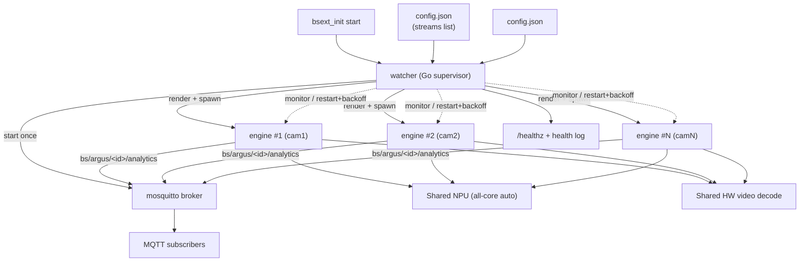

# Argus RTSP Watcher — Design

Design specification for the multi-stream supervisor described in
[`../VISION.md`](../VISION.md). This document is authoritative for implementation.

## 1. Overview

Argus RTSP Watcher is a **standalone** BrightSign native extension that runs the
Argus person + gaze analytics pipeline on **multiple RTSP camera feeds** from a
single NPU-equipped player. It consists of:

- A **lean C++ engine** (person + gaze), copied and adapted from
  `argus-audience-measurement-extension`, that processes **one** RTSP stream per
  process, driven entirely by a config file.
- A **Go supervisor** (`watcher`) that reads a streams list, generates one engine
  config per stream, and launches / monitors / restarts N engine processes with
  isolated per-instance environments.

The project is self-contained: it copies the source it needs from argus (no
submodules, no linking, no shared build), owns that code, and builds everything
through its own Makefile.

Design goals, non-goals, users, hardware tiers, and success criteria are defined
in `VISION.md` and not repeated here except where they constrain implementation.

## 2. Architecture



The watcher assumes the lifecycle responsibilities the current single-instance
`bsext_init` holds: it starts mosquitto once, spawns each engine in its own
process group with an isolated environment, and supervises each independently so a
single camera or engine failure never affects the others.

## 3. Project Layout

```
argus-rtsp-watcher/
  Makefile                     # build | test | clean | run-tests (default: list targets)
  VISION.md
  docs/
    DESIGN.md                  # this document
  cmd/
    watcher/                   # Go supervisor entry point (main.go)
  internal/                    # Go supervisor packages
    config/                    # config.json load + discovery order + validation
    configgen/                 # render config.json -> per-instance configs
    supervisor/                # child lifecycle, process groups, restart/backoff
    health/                    # /healthz endpoint + structured health log
    platform/                  # SoC detection, tier/capacity table, env setup
  engine/                      # C++ engine (lean person+gaze), copied/adapted from argus
    src/  include/  CMakeLists.txt
  models/                      # .rknn model files per SoC (RK3588/RK3576/RK3568)
  packaging/
    bsext_init                 # init script: launches watcher
    make-extension-lvm         # LVM image packaging (adapted from argus)
  configs/
    config.json       # per-instance engine config template
  examples/
    config.example.json       # example streams list (default baked into the extension)
  scripts/
    build.sh                   # cross-compile orchestration, invoked by Makefile
  test/                        # integration tests (file-input based)
```

Go module path and package boundaries follow standard library conventions. Each
`internal/` package has one clear purpose and a small interface so the supervisor
logic is unit-testable without hardware.

## 4. The Lean Engine

### 4.1 Included (person + gaze)

Copied and adapted from argus:

- **RTSP input**: `input_factory`, `input_rtsp` (GStreamer), `input_source`,
  `media_probe`.
- **Test input**: `input_file` (video-file playback) — retained solely for tests.
- **Models**: YOLOX person detection (`model_runner_yolox`, `yolox`,
  `postprocess`), RetinaFace face/landmarks (`model_runner_retinaface`,
  `retinaface`, `rknn_box_priors`), `model_factory`.
- **Gaze**: `attention` (geometric gaze from landmarks; no extra NPU model).
- **Tracking**: `tracker`, `byte_tracker_lite`, `kf_diag2d`.
- **Orchestration/pipeline**: `orchestrator`, `inference_worker`,
  `capture_worker`, `preprocess_stage`, `postprocess_stage`, `inference_stage`,
  `frame_mailbox`, `shared_frame`.
- **NPU/memory**: `resource_manager`, `rga_context`, `tensor_manager`, `mem_pool`,
  RKNN runtime bindings, `rknnPool`, `ThreadPool`.
- **MQTT output**: `mqtt_publisher`, `mqtt_broker`, `async_publisher`,
  `publisher_factory`.
- **Config/health/metrics/support**: `configuration`, `config_monitor`,
  `runtime_settings`, `processing_params`, `health_manager`, `backoff`,
  `metrics/*`, `device_info`, `image_utils`, `file_utils`, `utils`, `queue`, and
  image/JPEG/DRM/RGA helper libs.

### 4.2 Dropped (not copied)

Employee/vest detection (`model_runner_mobilenetv3` + `employee_detection`/
`uniform_model`), debug visualization (`visualization`, `annotator`,
`frame_writer`, `image_drawing`, `font`), `image-stream-server`, `face_blur`,
alternate publishers (`udp_json_publisher`, `brightsign_v3_publisher`,
`file_sinks`), alternate inputs (`input_usb`, `input_from_registry`,
`registry_helper`), demo licensing (`demo_license_checker`, `runtime_tracker`),
and legacy/unused code (`processing_pipeline`, `orchestrator_fixed`,
`audio_utils`).

Dropped modules are copied source we control; any can be re-added later if
required.

### 4.3 Required engine modifications

The engine is otherwise config-driven and needs no per-stream special-casing. Two
changes are required for clean multi-instance operation:

1. **All-core NPU scheduling.** Today the engine pins each model to a fixed NPU
   core via `rknn_set_core_mask` and skips setting a mask when `npu_core < 0`. Add
   an explicit "auto/all-core" mode that sets `RKNN_NPU_CORE_0_1_2` (multi-core
   parts) so the RKNN runtime load-balances every stream's inferences across the
   NPU. On RK3568 (single core) this resolves to the one available core. Selected
   via the generated config.

2. **Per-instance GStreamer registry.** The engine must honor a per-process
   `GST_REGISTRY` path so concurrent instances do not race on a shared registry
   file. This is an environment concern (set by the watcher, see §7.3); confirm
   the engine does not hard-code the registry path. No code change if it already
   reads `GST_REGISTRY` from the environment.

All other per-stream differences (input URL, MQTT topic, device id, target fps,
NPU mode, debug/output off) are expressed through the generated config, requiring
no engine code changes.

## 5. Configuration Model

Two files with a clean separation of concerns:

### 5.1 `config.json` (operator-facing)

The only file a field technician edits. Lists the streams and global options.

```json
{
  "streams": [
    { "id": "entrance-north", "rtsp_url": "rtsp://192.0.2.101:8554/live", "target_fps": 10 },
    { "id": "entrance-south", "rtsp_url": "rtsp://192.0.2.102:8554/live", "target_fps": 10 },
    { "id": "checkout",       "rtsp_url": "rtsp://192.0.2.103:8554/live", "target_fps": 5  }
  ]
}
```

Per-stream fields: `id` (required, unique; basis for topic/device identity),
`rtsp_url` (required), `target_fps` (optional, default 10; intended operating
range 5–10), `zone` (optional `[x0,y0,x1,y1]`, normalized 0..1 — a custom
region of interest; when set, each track reports an additive `in_zone` boolean
when its feet fall inside), and optional overrides passed through to the
template (e.g. thresholds).

### 5.2 `config.json` (owned by the project)

A full engine config with placeholders, rarely edited. Keeps all engine knobs in
one place. Placeholders are substituted per stream during config generation.

### 5.3 `config.json` discovery order

First found wins; there is no CLI/env override:

1. `/storage/sd/configs/config.json`
2. `/storage/sd/config.json`
3. `/storage/ssd/configs/config.json`
4. `/storage/ssd/config.json`
5. package default (extension directory)

SD/SSD are the field-editable locations, so an inserted card wins over the
baked-in default.

### 5.4 Generated per-instance configs

These are **not** discovered. The watcher renders one concrete engine config per
stream to a runtime directory (`/tmp/argus-watcher/<id>.json`) and passes it to
the engine with an explicit `--config`, so the engine's own SD-override search
never interferes with generated configs.

## 6. Config Generation (`internal/configgen`)

Pure input → output transformation (unit-testable without hardware). For each
stream, render `config.json`, substituting:

| Engine config field | Source | Purpose |
|---------------------|--------|---------|
| `input_source` / `input.rtsp_url` | stream entry | Select RTSP camera |
| `publishers[].mqtt.topic` | `bs/argus/<id>/analytics` | Per-stream identity |
| `device_id` / stream label | `<id>` | Attribution inside the payload |
| `target_fps` | stream entry (default 10) | Bound NPU load via capture cap |
| `npu_core` / mode | all-core auto (§4.3) | NPU scheduling |
| MQTT host/port | localhost broker | Local broker |
| frame output / debug sinks | forced off | Production hygiene |

The stream `id` is validated (non-empty, unique, filesystem/topic-safe) before
generation.

## 7. Process Supervision (`internal/supervisor`)

### 7.1 Startup sequence

1. Detect SoC / tier; log detected tier and the safe stream capacity.
2. Warn (do not abort) if configured stream count exceeds the tier's safe
   capacity (§9).
3. Start **mosquitto once**; wait until it accepts connections.
4. Generate all per-instance configs.
5. Spawn engines with a **startup stagger** so N engines don't hit NPU init
   simultaneously.

### 7.2 Child lifecycle

- Each engine runs in **its own process group**, stopped by PID/group — never by
  `pkill -f <binary-name>`, so instances are isolated from one another.
- **Restart with bounded exponential backoff** (e.g. 250 ms → 8 s), per-stream
  restart counters, and a reset window after sustained health.
- **Graceful shutdown**: SIGTERM to each child → wait → SIGKILL fallback; then
  stop mosquitto.

### 7.3 Per-instance environment

Each engine is launched with an isolated environment:

- `GST_REGISTRY=/tmp/gst-<id>.bin` (eliminates the shared-registry race).
- The GStreamer/RKNN `LD_LIBRARY_PATH`, `GST_PLUGIN_PATH`, and related variables
  that the current `bsext_init` establishes, factored into `internal/platform`.
- `--config /tmp/argus-watcher/<id>.json`.

### 7.4 Live reconciliation

On `config.json` change, the watcher reconciles running children against the new
desired set: add a stream → spawn it; remove one → stop it; change a stream's URL
or settings → restart just that engine. Unaffected streams keep running.

## 8. Health (`internal/health`)

A `/healthz` HTTP endpoint plus a periodic structured log line reporting:

- Detected SoC / tier and configured-vs-safe stream count (with over-capacity
  warning).
- Per-stream state: `running` / `restarting` / `failed`, with restart counts and
  last-exit info.

This is the technician's single check that every camera is being served.

## 9. Hardware Tiers & Capacity

From `VISION.md`, enforced as a startup capacity warning:

| Platform | SoC | NPU | Safe capacity (person + gaze) |
|----------|-----|-----|-------------------------------|
| XT5 | RK3588 | 3-core, 6 TOPS | 3 streams @ 5–10 fps (primary; headroom for more) |
| XS6/XD6 | RK3576 | 2-core, 4 TOPS | 2–3 streams @ 5–10 fps (validate) |
| LS5 / HS5 | RK3568 | 1-core, 1 TOPS | 1 stream (multi-stream not supported at target fps) |

Rationale: 3 streams @ 10 fps = ~60 inferences/s, the same total NPU rate a single
stream at 30 fps already sustains today.

## 10. Build & Packaging

All build and test flows go through the **Makefile** (per project conventions);
`go build`/`go test` are never invoked directly. Required targets:

| Target | Purpose |
|--------|---------|
| `build` | Cross-compile the Go watcher + C++ engine for all supported SoCs; produce the extension package(s) |
| `test` | Run the full test suite |
| `run-tests` | Alias/entry used by tooling to run tests |
| `clean` | Remove build/staging/artifacts |
| (default) | Print the list of targets |

- **Cross-compilation** uses the BrightSign aarch64 toolchain/SDK for the C++
  engine (containerized, matching argus's flow) and Go cross-compilation
  (`GOOS=linux GOARCH=arm64`) for the watcher, both orchestrated by
  `scripts/build.sh`.
- **Packaging** produces a BrightSign LVM extension via
  `packaging/make-extension-lvm` (adapted from argus). The package contains: the
  `watcher` binary, the engine binary, models per SoC, mosquitto, the required
  GStreamer/RKNN/RGA libraries, `bsext_init`, `config.json`, and the
  default `config.json`.
- **`bsext_init`** is reduced to: set up the shared library environment, then
  `start`/`stop`/`restart` the single `watcher` process (which owns mosquitto and
  all engines). It no longer launches an engine directly and no longer kills by
  process name.

## 11. Testing Strategy

Test-driven where practical; hardware-independent logic is fully unit-tested.

- **`internal/config`**: discovery order (SD/SSD/configs precedence), parse and
  validation (missing/duplicate ids, bad URLs).
- **`internal/configgen`**: template rendering → expected engine config
  (substitution correctness, forced-off debug fields, topic/device derivation).
  Pure functions, table-driven tests.
- **`internal/supervisor`**: restart/backoff logic and reconciliation against a
  **fake process launcher** behind a small interface (no real processes). Verifies
  isolation (one child failing does not affect others), backoff bounds, and
  add/remove/restart reconciliation.
- **`internal/platform`**: SoC detection parsing and tier/capacity decisions from
  fixture inputs.
- **Engine**: retain argus's applicable unit tests for the copied modules
  (postprocessing, tracking, input factory, config parsing).
- **Integration**: end-to-end run using `input_file` (looped test video) driving
  the real engine through the watcher, asserting per-stream MQTT output on
  distinct topics. Runs in CI without cameras or NPU where the runtime allows;
  hardware-in-the-loop validation on XT5/XS6/XD6 for throughput and stability.

Per project rules, tests are never skipped or stubbed to pass; only a human may
disable a test.

## 12. Risks & Open Questions

Resolved during implementation; none change the design's shape:

- **Per-tier RAM footprint.** N engine processes load model weights N times.
  Measure actual footprint on each tier and confirm headroom for the safe stream
  counts; if XS6/XD6 RAM is tight at 3 streams, that lowers its documented capacity.
- **RKNN all-core behavior under contention.** Validate that
  `RKNN_NPU_CORE_0_1_2` scheduling across N processes achieves the expected
  per-stream fps without starvation; if not, revisit with a watcher-side core
  assignment policy.
- **Concurrent GStreamer init.** Confirm per-instance `GST_REGISTRY` fully
  removes startup races; the startup stagger is the fallback mitigation.
- **mosquitto readiness detection.** Define the "broker accepting connections"
  check used before spawning engines.
- **Toolchain packaging in a standalone repo.** Confirm the BrightSign SDK
  acquisition/caching step for a self-contained build.

## 13. Related

- [`superpowers/specs/2026-10-24-light-dark-detection-design.md`](superpowers/specs/2026-10-24-light-dark-detection-design.md)
  — per-stream light/dark scene detection (IR-aware): `bs/argus/<id>/light`
  topic (retained, QoS 1), analytics schema `analytics/v7.1`, and the per-stream
  `light` config block. User-facing summary in the README.

- [`../VISION.md`](../VISION.md) — what and why.
- `argus-audience-measurement-extension` — source of the copied engine and the
  build/packaging patterns this project adapts.
