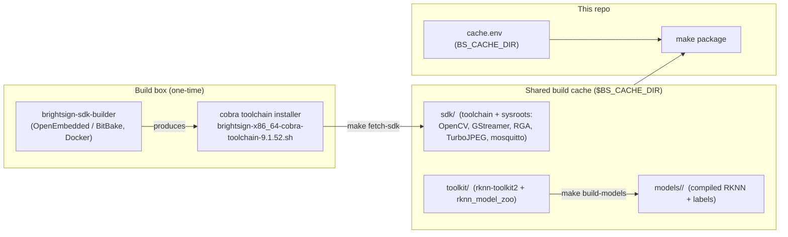

# Prerequisites: SDK, Shared Build Cache, and Repo Configuration

Before you can build this extension you need a cross-compile **SDK** and a few
large, expensive artifacts (NPU model toolkit, compiled models). These are
**identical across BrightSign NPU projects**, so they do **not** live in this
repo. They live in a **shared build cache outside the repo**, are built **once
per build box**, and are reused by every project (this repo and the sibling
`brightsign-voice-llm-extension` share the same cache and the same cobra SDK).

This repo is a *consumer* of that cache. `scripts/lib/cache.sh` is the single
source of truth for where the cache is; you point the repo at it with
`BS_CACHE_DIR` (via `cache.env`).



> **TL;DR for a box that already has the cache:** set `BS_CACHE_DIR` in
> `cache.env`, run `make cache-info` to confirm, then `make package`.

---

## Supported targets

This extension builds for **three SoCs**:

| Player | SoC | Build dir | Staging dir |
|---|---|---|---|
| XT5 | `rk3588` | `build/rk3588` | `staging/RK3588` |
| XS6 / XD6 | `rk3576` | `build/rk3576` | `staging/RK3576` |
| LS5 / HS5 | `rk3568` | `build/rk3568` | `staging/RK3568` |

The C++ engine (`argus-engine`), the Go watcher, the config-server, mosquitto,
the image-stream-server, and MediaMTX are all generic `aarch64` and built once,
then staged into every per-SoC directory. **Only the `.rknn` models are
SoC-specific.**

---

## Prerequisites (host)

- **x86_64 Linux** host. Apple Silicon is not supported.
- **Docker** (daemon running) — only for `make build-models` (RKNN quantization).
- **Go 1.22+** — the watcher and config-server are pure-Go, cross-compiled with
  `GOOS=linux GOARCH=arm64`.
- Host tools: `git`, `wget`/`curl`, `tar`, `cmake`, `make`, `g++` (for the
  host-side engine tests), `unzip`, `zip`, `mksquashfs` (squashfs-tools).
- **~25 GB+ free disk** for the SDK; another ~10 GB if you compile models.
- Network access to BrightSign S3, GitHub, `fftw.org` is not needed here, but
  `mosquitto.org` is (see the [mosquitto note](#mosquitto-source-tarball) below).

---

## Phase 1 — Populate the shared cache (one-time per box)

Skip this entire phase if you are joining a box that already has a populated
cache — jump to [Phase 2](#phase-2--configure-this-repo). Check with
`make cache-info`.

> **The SDK build is automatic.** When the cache is configured but empty,
> `make build` (through its `fetch-sdk` dependency) **builds the SDK for you** by
> invoking the sibling `brightsign-sdk-builder` — no manual step. It needs Docker,
> ~25 GB, and network, and takes hours the first time; afterward every project
> reuses it. The steps below document what that does and how to run it by hand, or
> you can opt out with `AUTO_BUILD_SDK=0` (then provision it yourself). You still
> need to compile the **models** once (step 3) — that is a separate cache artifact.

### 1. Build the cross-compile SDK

The SDK is produced out-of-repo by the **`brightsign-sdk-builder`** repo
(OpenEmbedded/BitBake in Docker), which bakes the extra runtime libraries this
engine links — **OpenCV, GStreamer, RGA, TurboJPEG, mosquitto client libs** —
into the sysroot via its `meta-bs` layer. The result is a single installer,
`brightsign-x86_64-cobra-toolchain-9.1.52.sh`.

> Because `meta-bs` already provides every library the engine links, this repo
> needs **no** extra "sdk-libs" cross-build step (unlike the voice extension,
> which cross-builds audio libraries the base SDK lacks).

### 2. Install the SDK into the cache

The OE installer **bakes its own absolute path** at install time, so install it
directly into its final cache location — never copy an already-extracted `sdk/`
around.

```bash
export BS_CACHE_DIR=/path/to/argus-build-cache     # outside the repo
mkdir -p "$BS_CACHE_DIR"
cp brightsign-x86_64-cobra-toolchain-9.1.52.sh "$BS_CACHE_DIR"/

# Installs + self-relocates the SDK into $BS_CACHE_DIR/sdk and fetches librknnrt.so:
make fetch-sdk SDK_INSTALLER="$BS_CACHE_DIR/brightsign-x86_64-cobra-toolchain-9.1.52.sh"
```

`make fetch-sdk` validates that the installed `environment-setup-aarch64-oe-linux`
references this cache's sysroot, and fetches the Rockchip NPU runtime
`librknnrt.so` (RKNN **v2.3.0**) into the sysroot. If the cache already has a
self-consistent SDK it is a no-op.

### 3. Compile the NPU models into the cache

```bash
make build-models
```

First run clones `rknn-toolkit2` + `rknn_model_zoo` (**v2.3.0**) into the cache
`toolkit/`, builds the `rknn_tk2` Docker image, downloads the upstream ONNX, and
quantizes (`i8`) per SoC into `$BS_CACHE_DIR/models/<SOC>/`:

| File | Source model |
|---|---|
| `RetinaFace.rknn` | `RetinaFace_mobile320.onnx` |
| `yolox_s.rknn` | `yolox_s.onnx` |
| `coco_80_labels_list.txt` | COCO label list (spaces → underscores) |

Needs Docker + ~10 GB + network. Subsequent runs short-circuit.

### 4. mosquitto source tarball {#mosquitto-source-tarball}

`make build-mosquitto` compiles the mosquitto broker (**2.0.18**) from source,
downloaded from `mosquitto.org` — which is frequently unreachable (IPv6-only). If
the download fails, seed the tarball into the repo's `build/` dir before building:

```bash
mkdir -p build
cp mosquitto-2.0.18.tar.gz build/     # any valid 2.0.18 source tarball
```

---

## Phase 2 — Configure this repo

Create `cache.env` at the repo root (git-ignored; see
[`cache.env.example`](../cache.env.example)):

```make
BS_CACHE_DIR := /path/to/argus-build-cache
```

A relative value resolves against the repo root; the default (if `cache.env` is
absent and `BS_CACHE_DIR` is unset) is `../argus-build-cache`, parallel to this
checkout. Then confirm the repo and cache agree:

```bash
make cache-info     # prints resolved cache/sdk/toolkit/models paths and presence
make fetch-sdk      # expect: "SDK already installed and self-consistent at ..."
```

---

## Build, test, package

```bash
make run-tests      # host-side: C++ engine unit tests (g++) + `go test ./...` (no SDK)
make build          # == make package: cross-compile, stage all 3 SoCs, emit zips
```

`make build` (an alias for `make package`) auto-provisions through its
dependencies — `prep` (RKNN headers), `fetch-sdk`, `build-engine`,
`build-watcher`, `build-config-server`, `build-image-server`, `build-mosquitto`,
`build-libs`, `build-models`, `build-mediamtx` — then stages
`staging/<SOC>/{watcher,argus-engine,config-server,image-stream-server,mediamtx,
bin,lib,model}` and produces two zips in the repo root:

- `argus-rtsp-watcher-<ts>.zip` — dev bundle (whole staging tree).
- `argus-rtsp-watcher-ext-<ts>.zip` — production: `ext_npu_watch.squashfs`
  + `ext_npu_watch_install-lvm.sh`.

Build one SoC at a time with e.g. `make build-engine TARGET_SOC=rk3576`.

Deploy with `make copy` (needs `BS_PLAYER` + `BS_PASSWORD` in `.envrc`; see
`envrc-example`), then run the printed `install-on-player.sh` on the player.

---

## Pinned versions

| Component | Version |
|---|---|
| Cobra toolchain SDK | 9.1.52 |
| RKNN runtime + toolkit | v2.3.0 |
| mosquitto | 2.0.18 |
| MediaMTX | v1.21.1 |
| GoogleTest (engine tests) | v1.14.0 |

---

## Troubleshooting

| Symptom | Cause | Fix |
|---|---|---|
| `make cache-info` shows `sdk ... [absent]` | `BS_CACHE_DIR` wrong or cache not populated | Fix `cache.env`; run Phase 1 |
| `fetch-sdk`: "exists but is not self-consistent" | An `sdk/` relocated for a different path was copied in | `rm -rf $BS_CACHE_DIR/sdk` and re-install from the installer |
| `build-engine`: headers like `rknn_api.h` not found | `make prep` has not fetched the Rockchip headers | `make prep` (needs network) |
| `build-mosquitto`: download failed | `mosquitto.org` IPv6-only / unreachable | Seed `build/mosquitto-2.0.18.tar.gz` (Phase 1, step 4) |
| `build` stops: "missing NPU models for RK35xx" | Models not compiled into the cache | `make build-models` (Docker) |

---

## Why a shared cache?

The SDK (~hours, ~25 GB), the RKNN toolkit, and the compiled models are expensive
and identical across BrightSign NPU extensions. Keeping them in one cache outside
the repos means they are built once per box and reused, the repos stay small, and
every project resolves the same absolute SDK path (which the OE installer bakes in
at install time).
