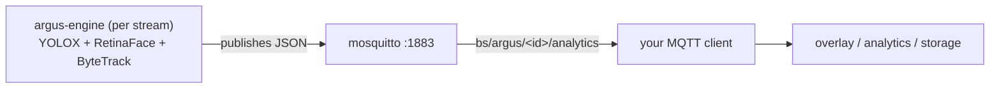

# Getting live bounding-box data over MQTT

This guide covers how to consume the per-person **bounding boxes** (and gaze/face boxes) that Argus RTSP Watcher publishes for every camera, in real time, over MQTT.

If you only want the box coordinates for an overlay or analytics, this is the document you need. It describes the broker, the topics, the exact message schema, the coordinate system, and working consumer code.

## The short version

- **Broker:** the player runs a mosquitto broker on TCP **1883**, anonymous (no auth), plain MQTT 3.1.1, **QoS 0**, not retained.
- **Topics:** one per stream — `bs/argus/<stream-id>/analytics`. Subscribe to all with `bs/argus/#`.
- **Rate:** about one message per second per stream (`period_ms: 1000`).
- **Boxes:** in the `tracks[]` array. `tracks[i].bbox` is the **person** box; `tracks[i].gaze.face_bbox` is the **face** box (present when a face was matched to that person).
- **Coordinates:** pixels in the source frame, `[x0, y0, x1, y1]` (top-left, bottom-right), origin top-left. The frame size is the top-level `frame_w` × `frame_h`.

```sh
mosquitto_sub -h <player-ip> -t 'bs/argus/#' -v
```

## Data flow



Each stream's engine detects people (YOLOX), detects faces and gaze (RetinaFace + landmark geometry), tracks people across frames (ByteTrack), and once per second publishes the current tracks to that stream's topic.

## Topics

The stream `id` from `config.json` becomes the topic segment. For the example config:

| Stream `id` | Topic |
|-------------|-------|
| `lobby` | `bs/argus/lobby/analytics` |
| `entrance` | `bs/argus/entrance/analytics` |
| `aisle` | `bs/argus/aisle/analytics` |

Wildcards: `bs/argus/#` (everything) or `bs/argus/+/analytics` (all analytics topics). The message also carries `device` and `stream` fields so a wildcard subscriber can still tell cameras apart.

## Message schema (`analytics/v7.0`)

One JSON object per message. Annotated example (two people, one looking at the display):

```json
{
  "schema": "analytics/v7.0",
  "ts": 164.68,
  "device": "aisle",
  "stream": "aisle",
  "frame_seq": 48213,
  "frame_ts": 1735689123456,
  "frame_w": 1024,
  "frame_h": 576,
  "model": "yolox_s",
  "fw_version": "7.0.0",
  "npu_load": 42.0,
  "people": 2,
  "people_confident": 2,
  "gaze": 1,
  "fps": 10,
  "scene": { "person_count": 2, "employee_count": 0, "customer_count": 0, "unknown_uniform_count": 2 },
  "roi": { "type": "border", "border_frac": 0.30, "rect": [307, 172, 716, 403] },
  "health": { "detector_fps": 10.0, "tracker_fps": 10.0, "queue_latency_ms": 0, "dropped_frames": 0, "last_model_reload_ts": 0.0 },
  "tracks": [
    {
      "id": 63,
      "state": "Confirmed",
      "bbox": [52.9, 227.4, 286.6, 560.0],
      "score": 0.93,
      "zones": ["roi"],
      "dir": "UR", "deg": 41.0, "dir_conf": 0.80,
      "speed": 12.3, "speed_norm": 0.012,
      "dwell": 31.03, "enter": false, "exit": false,
      "uniform": { "class": "unknown", "confidence": 0.0, "is_employee": false },
      "gaze": { "detected": 1, "time": 8.00, "face_bbox": [231.0, 167.0, 240.0, 180.0] }
    },
    {
      "id": 71,
      "state": "Confirmed",
      "bbox": [640.0, 210.0, 820.0, 540.0],
      "score": 0.88,
      "zones": [],
      "dir": "?", "deg": 0.0, "dir_conf": 0.0,
      "speed": 0.0, "speed_norm": 0.0,
      "dwell": 4.10, "enter": true, "exit": false,
      "uniform": { "class": "unknown", "confidence": 0.0, "is_employee": false }
    }
  ]
}
```

Note the second track has **no `gaze` object** — the `gaze` key is present only when a face was matched to that person this frame.

### Top-level fields

| Field | Type | Meaning |
|-------|------|---------|
| `schema` | string | Always `analytics/v7.0`. |
| `ts` | float | Timestamp in seconds (monotonic since engine start). |
| `device` | string | The stream `id` (from `config.json`). |
| `stream` | string | Stream identifier. |
| `frame_seq`, `frame_ts` | int | **Video/MQTT sync key.** `frame_seq` is the capture sequence number burned into the matching annotated frame's stamp; `frame_ts` is that frame's capture wall-clock time, epoch milliseconds. See the "Frame stamp" section below. |
| `frame_w`, `frame_h` | int | **Source frame dimensions in pixels — the coordinate space for all boxes.** |
| `model` | string | Detector model name. |
| `fw_version` | string | Schema/firmware version. |
| `npu_load` | float | Approximate NPU load (%). |
| `people` | int | Number of tracks in this message (= `tracks.length`). |
| `people_confident` | int | Tracks with `score >= 0.70`. |
| `gaze` | int | Number of people currently looking at the display. |
| `fps` | int | Processing frame rate. |
| `roi` | object | Region of interest: a border inset (`border_frac`) and its pixel `rect` `[x0,y0,x1,y1]`. |
| `health` | object | `detector_fps`, `tracker_fps`, `queue_latency_ms`, `dropped_frames`, `last_model_reload_ts`. |
| `scene` | object | Person/employee/customer counts. **Vestigial in this build** — employee/customer classification was dropped, so `employee_count`/`customer_count` are always 0 and everyone is `unknown`. |
| `tracks` | array | One entry per detected person (see below). |

### Per-track fields (`tracks[]`)

| Field | Type | Meaning |
|-------|------|---------|
| `id` | int | **Stable track ID** — the same person keeps the same id across frames. |
| `state` | string | Tracker state (`Confirmed`). |
| **`bbox`** | `[x0,y0,x1,y1]` float | **Person bounding box**, pixels, top-left to bottom-right. |
| `score` | float | Detection confidence (0–1). |
| `zones` | string[] | Zones the person is in, e.g. `["roi"]`. |
| `dir` | string | 8-way compass direction of movement (`R,UR,U,UL,L,DL,D,DR`, or `?`). |
| `deg` | float | Direction in degrees. |
| `dir_conf` | float | Direction confidence (0–1). |
| `speed` | float | Speed in pixels/second. |
| `speed_norm` | float | Speed normalized to the frame diagonal. |
| `dwell` | float | Seconds the person has been tracked in the area. |
| `enter` | bool | True on the frame the person entered. |
| `exit` | bool | True on the frame the person left. |
| `uniform` | object | `{class, confidence, is_employee}`. **Vestigial** — always `{"unknown", 0.0, false}` in this build. |
| `gaze` | object? | Present only when a face matched this person. `detected` (1 = looking at display), `time` (accumulated seconds of gaze), and **`face_bbox`** `[x0,y0,x1,y1]` — the **face bounding box**, pixels. |
| `in_zone` | bool | Present only when the stream has a custom `zone` configured. `true` when this person is in the zone under the stream's `zone_mode`: `any` (default — any part of the box overlaps the zone) or `base` (box feet/bottom-center inside). Additive to `zones`. |

## The bounding boxes, precisely

Two boxes per person, both `[x0, y0, x1, y1]` in **source-frame pixels**:

- **Person box** — `tracks[i].bbox`. Always present.
- **Face box** — `tracks[i].gaze.face_bbox`. Present only when `tracks[i].gaze` exists (a face was matched). Use `tracks[i].gaze.detected == 1` to know if that face is looking at the display.

Coordinate system:

```
(0,0) ── x ──▶ (frame_w, 0)
  │        ┌───────────────┐  (x0,y0) top-left
  y        │    person     │
  │        └───────────────┘  (x1,y1) bottom-right
  ▼
(0, frame_h)
```

- Origin is the top-left of the frame.
- `x` grows right to `frame_w`; `y` grows down to `frame_h`.
- `(x0,y0)` is the top-left corner, `(x1,y1)` the bottom-right. Width = `x1 - x0`, height = `y1 - y0`.

### Scaling to a display

If you render the video at some `displayW × displayH` (different from `frame_w × frame_h`), scale each coordinate:

```
sx = displayW / frame_w
sy = displayH / frame_h
drawRect(x0*sx, y0*sy, (x1-x0)*sx, (y1-y0)*sy)
```

Use `frame_w`/`frame_h` from the same message — don't hard-code, since different cameras have different resolutions.

## Frame stamp (video ↔ MQTT sync)

If you also record the annotated video (the decorated frames the engine writes when `enable_frame_output` is on), the recording and the MQTT stream are two independent outputs with no shared clock by default. The frame stamp closes that gap: every annotated frame carries the same `frame_seq`/capture time that its corresponding MQTT message carries, so a recorder can join a saved frame back to the exact MQTT message it was detected in.

### The two MQTT fields

| Field | Type | Meaning |
|-------|------|---------|
| `frame_seq` | int | Capture sequence number — the same value burned into the matching annotated frame's stamp (below). Monotonically increasing per stream. |
| `frame_ts` | int | Capture wall-clock time for that frame, **epoch milliseconds** (`CLOCK_REALTIME`, not monotonic uptime — comparable across restarts and hosts). |

These are cheap top-level metadata and are always present, independent of `enable_frame_stamp` (the flag below only controls whether the visual stamp is drawn on the frame itself).

### The stamp burned into the frame

When `enable_frame_stamp` is true (default) and `enable_frame_output` is on, the engine burns two representations of the same `frame_seq`/capture time onto the annotated frame before writing it:

Both stamps are stacked in the **lower-left corner**: the human-readable line is pinned to the very bottom, and the machine-readable grid sits directly above it.

- **Human-readable** — `#<frame_seq>  <ISO-8601 UTC time, ms precision>` (e.g. `#48213  2024-12-31T23:52:03.456Z`) as white text on a filled dark background, pinned to the very bottom of the frame (baseline at `H - kStampMarginPx`). For eyeballing a clip.
- **Machine-readable** — a grid of solid black/white cells directly **above** the bottom text band, for a decoder to sample programmatically. The whole stamp **scales continuously with frame height `H`** so it reads the same at any resolution, and it's **bottom-anchored**. Each base size is scaled as `scaled(base) = max(base, round(base*H/kStampScaleRefPx))` (`kStampScaleRefPx` = 600): `cell = scaled(kStampCellPx)` (10px base), `margin = scaled(kStampMarginPx)` (4px base), `text_band = scaled(kStampTextBandPx)` (28px base). Constants are named in `draw_frame_stamp()`, `engine/src/orchestration/inference_worker.cpp`.
  - **Text band**: the bottom `text_band` px hold the human-readable line; the grid sits above it.
  - **Quiet zone**: a solid black rectangle, one `cell` wide on every side of the bit grid, with its bottom edge at `H - text_band`.
  - **Bit grid**: `kStampCols` x `kStampRows` = 8 x 9 cells, each `cell` x `cell` px (≥10px — above the 8x8px floor needed to survive JPEG recompression). Cell top-left corner for grid cell `[row, col]` is at `(grid_x0 + col*cell, grid_y0 + row*cell)`, where `grid_x0 = margin + cell` and `grid_y0 = H - text_band - (kStampRows+1)*cell`.
  - **Cell color**: pure black `(0,0,0)` = bit `0`, pure white `(255,255,255)` = bit `1`.
  - **Bit order**: rows 0-7 hold the 8 bytes of the 64-bit `frame_seq`, **MSB-first** (row 0 = bits 63-56, row 7 = bits 7-0). Row 8 holds an 8-bit **XOR checksum** of those 8 bytes. Within a row, column 0 holds that byte's MSB (bit 7) through column 7 holding its LSB (bit 0).
  - **Decoding**: compute `cell`, `margin`, `text_band`, and `grid_y0` from the frame height, sample the center pixel of each of the 72 cells (`grid_x0 + col*cell + cell/2`, `grid_y0 + row*cell + cell/2`), threshold each to a bit, reassemble the 8 seq bytes MSB-first into a `uint64_t`, then XOR those 8 bytes yourself and compare against row 8 — a mismatch means the read is unreliable (compression artifact, misaligned crop, etc.) and should be discarded rather than trusted. The `tools/framebox` command and `docs/recording-and-sync.md` carry a full worked decoder.
  - The pure byte/checksum encoder (`encode_frame_stamp_bytes()`, `engine/include/orchestration/frame_stamp.h`) is unit tested independently of the drawing code and is the authoritative reference for the byte order and checksum if this description and the code ever disagree.

### Config

`enable_frame_stamp` (default `true`) in the engine config controls only the burned-in visual stamp; it has no effect on the always-present `frame_seq`/`frame_ts` MQTT fields.

## Custom zone

When you add a `zone` field to a stream in `config.json`, each track will report an additional `in_zone` boolean. The zone is specified as `[x0,y0,x1,y1]` with all values in the range `[0,1]` (normalized frame coordinates), e.g., `"zone": [0.146, 0.104, 0.781, 0.972]`. This is useful for counting people in an "important area" (checkout queue, parking space, aisle) without setting up separate ROI engines.

An optional per-stream `zone_mode` selects how `in_zone` is decided:

- `"any"` (default): `true` when **any part** of the person's bounding box overlaps the zone.
- `"base"`: `true` only when the person's **feet** (box bottom-center) are inside the zone.

A few optional per-stream fields control how the zone is drawn and counted on the annotated frame:

- `zone_color` — outline color as a `#RRGGBB` hex string (default `#ffffff`, white).
- `zone_thickness` — outline width in pixels, `1`–`10` (default `3`).
- `zone_border_thickness` — red alert-border width in pixels, `1`–`100` (default `20`), independent of the outline width.
- `zone_window_minutes` — rolling window for the on-frame detect counter, `1`–`1440` (default `15`).

```json
{ "id": "checkout", "rtsp_url": "rtsp://…", "zone": [0.146, 0.104, 0.781, 0.972], "zone_mode": "base", "zone_color": "#ff8800", "zone_thickness": 4, "zone_window_minutes": 15 }
```

Editing any of these in `config.json` triggers a live restart of only that camera's engine — no need to reboot the extension. The on-player **zone dashboard** (port `20300`) lets you draw the zone on each camera's live view, flip the any/base toggle, pick the outline color and line width, set the count window, and Save per pane. The companion `tools/boxstats` tool can answer offline area-range questions from recorded video.

### On-frame detect counter and red alert border

The engine draws two things on the annotated frame (the preview feed and the video walls) for a stream with a zone:

- **Detect counter** — the number of distinct in-zone detection episodes in the last `zone_window_minutes`, drawn in the upper-right corner in the zone's color, at the frame-stamp text size. A new episode is counted when the zone goes from empty to occupied; continuous presence counts once.
- **Red alert border** — a red border (width = `zone_border_thickness`, independent of the outline) burned around the whole frame while the zone is triggered. It fires on the first in-zone frame and holds solid across brief detection gaps, clearing shortly after the trigger condition clears. The bundled video walls (`presentation/`, `presentation2/`) simply display the feeds, so this border appears there automatically — there is no browser-side flashing.

### Low-latency in-zone event (`zone_event`)

The per-track `in_zone` field above rides the regular analytics message, which is throttled to one publish per second. For external consumers that want a fast signal, a stream with a zone also publishes a dedicated event on a sibling topic, **`bs/argus/<id>/zone_event`**, the moment **two in-zone detections land within a rolling 1-second window** (using the same `any`/`base` predicate). It then repeats at most every 500 ms while in-zone activity continues, and stops when it ends. This bypasses the 1 Hz analytics tick, so consumers react within a frame or two instead of up to a second.

```json
{ "device_id": "checkout", "event": "in_zone", "in_zone": 2, "mode": "base", "ts_ms": 1733520000123 }
```

`in_zone` is the number of tracks inside the zone on the firing frame; `ts_ms` is a monotonic millisecond timestamp. (The in-frame red border is driven independently by the engine, not by this topic.)

## Consuming the data

### Command line

```sh
# everything, human-readable
mosquitto_sub -h <player-ip> -t 'bs/argus/#' -v

# one camera, pipe through jq to pull just the boxes
mosquitto_sub -h <player-ip> -t 'bs/argus/lobby/analytics' \
  | jq -c '.tracks[] | {id, bbox, gaze: .gaze.face_bbox, looking: .gaze.detected}'
```

The `mosquitto_sub`/`mosquitto_pub` binaries are also bundled in the extension at `/var/volatile/bsext/ext_npu_argus_rtsp/<SOC>/bin/`.

### Python (paho-mqtt)

```python
import json
import paho.mqtt.client as mqtt

def on_message(_client, _userdata, msg):
    m = json.loads(msg.payload)
    cam = m["device"]
    fw, fh = m["frame_w"], m["frame_h"]
    for t in m["tracks"]:
        person = t["bbox"]                     # [x0, y0, x1, y1]
        gaze = t.get("gaze")                   # None if no face matched
        face = gaze["face_bbox"] if gaze else None
        looking = bool(gaze and gaze["detected"])
        print(f"{cam} id={t['id']} person={person} face={face} looking={looking} "
              f"(frame {fw}x{fh})")

c = mqtt.Client()
c.on_message = on_message
c.connect("<player-ip>", 1883, keepalive=30)
c.subscribe("bs/argus/#", qos=0)
c.loop_forever()
```

### Node.js (mqtt)

```js
const mqtt = require("mqtt");
const client = mqtt.connect("mqtt://<player-ip>:1883");

client.on("connect", () => client.subscribe("bs/argus/#"));
client.on("message", (topic, payload) => {
  const m = JSON.parse(payload.toString());
  for (const t of m.tracks) {
    const person = t.bbox;                         // [x0,y0,x1,y1]
    const face = t.gaze ? t.gaze.face_bbox : null;
    const looking = !!(t.gaze && t.gaze.detected);
    console.log(m.device, t.id, person, face, looking, m.frame_w, m.frame_h);
  }
});
```

### Browser overlay (canvas over video)

Draw the boxes on a `<canvas>` layered over a video element (e.g. the RTSP stream via WebRTC/HLS, or the built-in MJPEG preview). Use a browser MQTT client over WebSockets, or relay MQTT→WebSocket from your app server.

```js
// video: the <video>/ element; canvas: an overlay sized to match it
function draw(m) {
  const sx = canvas.width / m.frame_w;
  const sy = canvas.height / m.frame_h;
  ctx.clearRect(0, 0, canvas.width, canvas.height);
  for (const t of m.tracks) {
    const [x0, y0, x1, y1] = t.bbox;
    ctx.strokeStyle = t.gaze && t.gaze.detected ? "lime" : "white";
    ctx.lineWidth = 2;
    ctx.strokeRect(x0 * sx, y0 * sy, (x1 - x0) * sx, (y1 - y0) * sy);
    ctx.fillText(`#${t.id} dwell ${t.dwell.toFixed(1)}s`, x0 * sx, y0 * sy - 4);
    if (t.gaze && t.gaze.face_bbox) {
      const [fx0, fy0, fx1, fy1] = t.gaze.face_bbox;
      ctx.strokeStyle = "cyan";
      ctx.strokeRect(fx0 * sx, fy0 * sy, (fx1 - fx0) * sx, (fy1 - fy0) * sy);
    }
  }
}
```

If you just want boxes-over-video without writing any of this, the extension already renders it — see the browser preview in the [README](../README.md#outputs).

## Notes and gotchas

- **Data only flows when the engines are running.** If `curl :9200/healthz` shows a stream's `Restarts` climbing, its engine can't open the RTSP source and nothing is published for it. Fix the stream first (see the README troubleshooting table).
- **QoS 0, not retained.** A subscriber that connects sees only messages published from then on — there's no last-value replay. Subscribe before you need the data.
- **The `gaze` object is optional per track.** Always null-check it before reading `face_bbox`/`detected`.
- **`uniform` and `scene` employee/customer fields are vestigial** in this person+gaze build — always default. Ignore them unless a future build re-adds the classifier.
- **Coordinates are per-message.** Read `frame_w`/`frame_h` from the same message you're drawing; cameras differ in resolution.
- **One broker, all streams.** All cameras publish to the single broker on the player; the topic's `<id>` segment is how you separate them.

## Related

- [README.md](../README.md) — overview, config, deploy.
- [docs/DESIGN.md](DESIGN.md) — how the pipeline produces these results.
