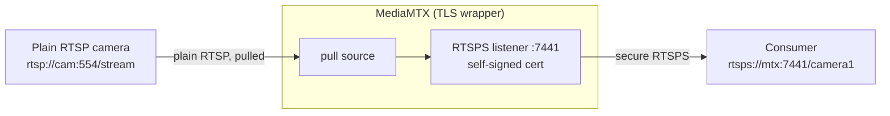

# MediaMTX: plain RTSP in, UniFi-style secure RTSP out

How to put a **plain `rtsp://` camera behind MediaMTX** and re-serve it as a
**secure `rtsps://` (RTSP-over-TLS) feed that looks like UniFi Protect** — same
scheme, same port, same self-signed-cert behavior.

Use this when a consumer expects a UniFi-style secure endpoint but the actual
source is an ordinary plain-RTSP camera, or when you want to add TLS to a feed
without touching the camera.

## What "the same as UniFi" means

UniFi Protect exposes cameras as:

```
rtsps://<nvr-ip>:7441/<stream-id>?enableSrtp
```

The parts that define it:

| Property | UniFi Protect | We reproduce it with |
|----------|---------------|----------------------|
| Scheme | `rtsps://` (RTSP over TLS) | MediaMTX RTSPS listener |
| Port | `7441` | `rtspsAddress: :7441` |
| Certificate | self-signed (clients skip verification) | self-signed cert via `openssl` |
| Media | RTP inside the TLS tunnel; `?enableSrtp` optionally SRTP-encrypts it | TLS tunnel only — **see caveat** |

> **Caveat — SRTP is not reproduced.** MediaMTX carries RTP *inside* the TLS
> connection, which matches UniFi's `rtsps://` transport. It does **not** emit
> UniFi's optional SRTP media layer (the `?enableSrtp` behavior). For every normal
> consumer this is indistinguishable; only tooling that specifically negotiates
> UniFi SRTP would notice. Do not advertise the output with `?enableSrtp`.

## Architecture



MediaMTX acts as an RTSP **client** toward the plain camera (the `source`) and an
RTSPS **server** toward consumers. The camera never needs to support TLS.

## Prerequisites

- MediaMTX (`bluenviron/mediamtx`; the `-ffmpeg` image if you also transcode).
- `openssl` to generate the self-signed certificate.
- A reachable plain `rtsp://` source URL.

## 1. Generate a self-signed certificate

UniFi uses a self-signed cert; so do we. Include the hostname/IP consumers will
use, so clients that check the name still match.

```sh
mkdir -p certs
openssl req -x509 -newkey rsa:2048 -nodes -days 3650 \
  -keyout certs/server.key -out certs/server.crt \
  -subj "/CN=mtx-secure" \
  -addext "subjectAltName=DNS:mtx-secure,IP:192.168.1.10"
```

Replace the `IP:`/`DNS:` with the address consumers will connect to.

## 2. Configure MediaMTX

`mediamtx.yml` — pull the plain feed, serve it as RTSPS on 7441:

```yaml
rtsp: yes

# Secure like UniFi: TLS-only RTSP on the UniFi port, self-signed cert.
rtspEncryption: strict          # serve ONLY rtsps:// (drop to "optional" to also keep plain :8554)
rtspsAddress: :7441
rtspServerCert: /certs/server.crt
rtspServerKey: /certs/server.key

# Not needed for this job.
rtmp: no
hls: no
webrtc: no
srt: no

paths:
  camera1:
    # The PLAIN upstream feed. MediaMTX connects to it as a client.
    source: rtsp://192.168.1.50:554/stream1
    # Pull only while a consumer is connected (omit to pull continuously).
    sourceOnDemand: yes
```

- `rtspEncryption: strict` makes the served endpoint TLS-only, matching UniFi. Use
  `optional` instead if you also want a plain `rtsp://…:8554/camera1` for local
  debugging (add `rtspAddress: :8554`).
- `source:` is the plain camera. The `source` connection is MediaMTX-as-client and
  is unaffected by `rtspEncryption` (which governs only the server side).
- Name the path anything (`camera1` here). UniFi uses long tokens; the name is
  arbitrary and becomes the URL path.

## 3. Run MediaMTX

```sh
docker run --rm \
  -p 7441:7441 \
  -v "$PWD/mediamtx.yml:/mediamtx.yml:ro" \
  -v "$PWD/certs:/certs:ro" \
  docker.io/bluenviron/mediamtx:latest-ffmpeg
```

Or run the `mediamtx` binary directly with the same `mediamtx.yml` and `certs/`
alongside it.

## 4. The secure URL

```
rtsps://<mediamtx-host>:7441/camera1
```

Same shape as UniFi (minus the `?enableSrtp` suffix, per the caveat above).

## 5. Verify

ffmpeg does not verify TLS certs by default, so a self-signed cert works the same
as pointing at a real UniFi NVR:

```sh
ffmpeg -rtsp_transport tcp -i rtsps://<mediamtx-host>:7441/camera1 -t 5 -f null -
```

You should see it read frames for 5 seconds with no TLS error.

## Consuming it elsewhere (self-signed cert)

Because the cert is self-signed, strict verifiers reject it — exactly as with
UniFi, where clients are told to skip validation:

- **ffmpeg / VLC / most players:** work as-is (no cert verification by default).
- **A downstream MediaMTX** pulling this as its own `source:` — if it rejects the
  self-signed cert, pin it with `sourceFingerprint:` (the SHA-256 of `server.crt`)
  on that path:
  ```sh
  openssl x509 -in certs/server.crt -noout -fingerprint -sha256
  ```
- **Code using libraries that verify by default** (Go, Python requests-style): add
  the usual "insecure skip verify" / trust-the-cert option, or add `server.crt` to
  the trust store.

## Variations

- **Publish instead of pull.** If nothing serves a plain URL to pull, push a feed
  into MediaMTX and still serve it as RTSPS. Replace the `source:` path with a
  `runOnInit` ffmpeg publish to the local plain endpoint (requires
  `rtspEncryption: optional` + `rtspAddress: :8554`):
  ```yaml
  paths:
    camera1:
      runOnInit: >
        ffmpeg -re -stream_loop -1 -i /video/clip.mp4
        -c:v copy -f rtsp -rtsp_transport tcp rtsp://localhost:8554/$MTX_PATH
      runOnInitRestart: yes
  ```
  Consumers still use `rtsps://host:7441/camera1`.
- **Transcode on the way through.** If the plain feed is H.265 and a consumer needs
  H.264, do it in the publish/`runOnInit` ffmpeg with `-c:v libx264 -preset veryfast
  -tune zerolatency` instead of `-c:v copy`.

## Config-key version note

The keys above are MediaMTX **v1.x** (what the `:latest` image is):
`rtspEncryption`, `rtspServerCert`, `rtspServerKey`, `rtspsAddress`. Older **v0.x**
used `encryption`, `serverCert`, `serverKey`. If you pin an old tag, translate
accordingly (`mediamtx --help` / the shipped default `mediamtx.yml` lists the exact
keys for your version).

## Related

- [README → RTSP sources & MediaMTX](../README.md#rtsp-sources--mediamtx) — the
  reverse direction (consuming a UniFi `rtsps://` source into the watcher).
- `test/rtsp-sim/` — the plain-RTSP simulator harness this config style is based on.
