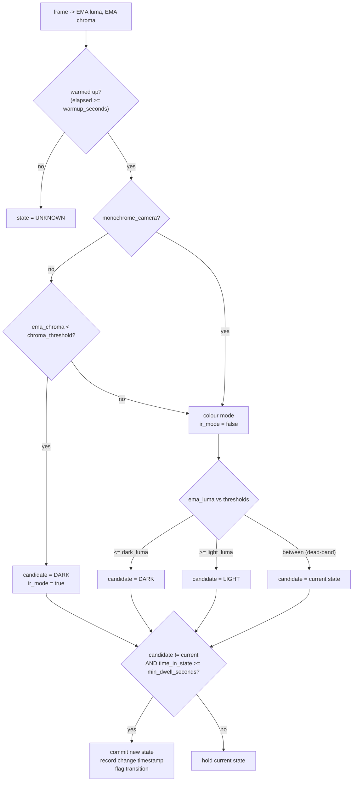

# Light/Dark Scene Detection — Design

Design specification for adding **ambient light/dark detection** to the Argus RTSP
Watcher engine, publishing it as a new MQTT channel and tagging detection events
with the current lighting. This document is authoritative for implementation; it
builds on [`../../DESIGN.md`](../../DESIGN.md) and does not repeat the existing
architecture except where this feature touches it.

## 1. Intent and the why

Software that reacts to Argus detection events needs to know **whether the real
world in the camera's view is light or dark** — e.g. to change signage content,
suppress actions at night, or interpret person counts differently after hours.

The hard part is that IP cameras switch to **IR / night mode** when ambient light
falls. In IR mode the camera turns on an infrared illuminator and the *image* can
be bright — even over-exposed — while the *scene* is pitch black. A naive
"average pixel brightness" test therefore fails exactly backwards: it would report
`LIGHT` at night under IR.

The consumer cares about the **real world**, not the image. So the detector must
treat IR/night mode itself as the primary "world is dark" signal.

## 2. Goals, non-goals, anti-goals

### Goals

- Per-stream detection of **real-world** light vs dark, robust to IR/night mode.
- A new MQTT topic `bs/argus/<id>/light` that publishes the current state and a
  "how light" measure **every X seconds**, where X is configurable per stream.
- An **immediate** publish on the same topic the moment the reported lighting
  changes (mirrors the existing `zone_event` low-latency pattern). "Changes" means
  the `(state, ir_mode)` pair differs from the last emitted one — so it fires on
  the first commit out of `UNKNOWN` at startup, and when a `DARK` scene transitions
  colour-dim -> true IR night (state stays `DARK` but `ir_mode` flips). See §4.3.
- The existing analytics message carries the lighting so that consumers reading
  detection events implicitly know the lighting: a scene-level `light` object
  **and** a compact `"light"` field mirrored onto every track.
- Configurable thresholds and smoothing so dusk/dawn and camera day/night hunting
  do not cause the state to flap.
- Light detection runs on **every captured frame regardless of detections**, so
  the light topic keeps reporting even in an empty scene.

### Non-goals

- No UI in the on-player config-server dashboard for light settings (config-file
  only for this change).
- No per-region or multi-zone lighting; one lighting state per stream/view.
- No colour-temperature / white-balance analysis beyond what IR detection needs.
- No change to the detection models or tracking.

### Anti-goals (would make this a failure even if it "works")

- Reporting `LIGHT` at night because the IR image is bright. This is the core
  failure the design exists to prevent.
- A state that flaps every few seconds at dusk/dawn or when a camera hunts between
  day and night mode.
- Measurable added latency or frame-rate loss on the capture path.

## 3. Decisions already made (by the project owner)

- **Field placement (Option A):** an authoritative scene-level `light` object in
  the analytics message, **plus** a compact `"light":"<STATE>"` mirrored onto each
  track.
- **Monochrome cameras:** none are permanently monochrome. The chroma-based IR
  test is valid. A per-stream `monochrome_camera` opt-out flag is still provided,
  defaulting `false`, for future always-mono feeds.
- **On-change events:** yes — periodic heartbeat **and** an immediate publish on
  state transition.

## 4. The detection algorithm

### 4.1 Per-frame measurement

Each captured frame is already copied once into `SharedFrame.bgr` (packed BGR24,
CPU memory) in `Orchestrator::capture_loop_threadfn`
(`engine/src/orchestration/orchestrator.cpp`). This is the single place pixel data
already lives on the CPU, so the measurement rides along there with no extra copy.

Over a **central ROI** (a centred box covering `roi_frac` of width and height) and
**subsampling** every `sample_stride`-th pixel in both axes, compute:

- **Mean luminance** `Y = 0.299*R + 0.587*G + 0.114*B` (BT.601), range `0..255`.
- **Mean chroma** `max(R,G,B) - min(R,G,B)`, range `0..255`.

The central ROI is used because scene lighting is most representative there and it
cuts the sample count; it is **not** for pad avoidance. `SharedFrame.bgr` is the
**full-resolution, unpadded camera frame** — capture color-converts only and does
not resize (RTSP pipelines pass `scaled_320=false`, `input_rtsp.cpp`), so a 1080p
stream yields a ~1920x1080 BGR buffer. The letterbox-to-320 happens **downstream**,
per inference worker, in a separate buffer (`resize_frame_rga(...)` in
`inference_worker.cpp`), never in `sf->bgr`. The analyzer therefore iterates over
the real `SharedFrame.width x SharedFrame.height`, which is cleaner for this feature
(no pad to skip).

> Cost / resolution: because the buffer is native resolution, a fixed
> `sample_stride` yields very different sample counts across resolutions
> (stride 8 is ~576 samples at 320x320 but ~32k at 1080p). To honour the
> "no measurable frame-rate loss" anti-goal, the stride is resolution-relative:
> derive it so the analyzer samples roughly a fixed **target sample count**
> (~1-4k pixels) per frame regardless of input size — e.g.
> `stride = max(1, round(sqrt(roi_pixels / target_samples)))`. `sample_stride` in
> config (§4.5) becomes the *minimum* stride / a cap, not an absolute. Measurement
> runs on the capture thread, so keep it to one linear pass with integer math.

### 4.2 Smoothing

Both metrics are fed through an exponential moving average (EMA) per frame:

```
ema = ema + ema_alpha * (sample - ema)
```

`ema_alpha` in `(0,1]`; smaller = smoother/slower. Smoothing at frame rate (not at
the 1 Hz publish cadence) is what makes the state stable.

### 4.3 State decision

States: `UNKNOWN`, `LIGHT`, `DARK`.



During warm-up the state is `UNKNOWN`; `ir_mode` is `false`, `level` is `0`, and
`luma`/`chroma` carry the current (still-converging) EMA values so a debugger sees
real numbers. The **on-change** predicate compares the emitted `(state, ir_mode)`
pair, and the minimum-dwell gate (below) applies to any change in that pair,
including `ir_mode` flips. The first commit out of `UNKNOWN` therefore fires a
`change` event, giving consumers the initial lighting immediately rather than after
up to `interval_seconds`.

Three mechanisms prevent flapping:

1. **Hysteresis** — separate `dark_luma` and `light_luma` thresholds with a
   dead-band between them (in colour mode); inside the band the state is held.
2. **IR primacy** — in colour cameras, `ema_chroma < chroma_threshold` means the
   camera has dropped to monochrome/IR, which *is* darkness, independent of image
   brightness. This is the anti-goal guard.
3. **Minimum dwell** — a committed state must persist at least
   `min_dwell_seconds` before it may change again.

For `monochrome_camera: true`, the chroma rule is skipped (chroma is always ~0 on
such a feed) and the decision is pure luminance. This is less robust against IR
illuminators and is documented as such; it is the only option possible for a feed
with no colour information.

### 4.4 The "how light" measure

A `level` integer `0..100` reflecting **real-world** light:

- IR/night mode (`ir_mode == true`): `level = 0` — the world is dark even though
  pixels may be bright.
- Colour mode: `level = round(100 * ema_luma / 255)`, clamped to `0..100`.

The raw `luma` and `chroma` EMAs and the `ir_mode` boolean are also published, so
operators can tune thresholds and debug without guessing.

### 4.5 Defaults

| Field | Default | Meaning |
|---|---|---|
| `enabled` | `true` | Run light detection for this stream. |
| `interval_seconds` | `10` | The "X": periodic light-topic publish period. |
| `dark_luma` | `40` | At/below this EMA luma (colour mode) -> DARK. |
| `light_luma` | `70` | At/above this EMA luma (colour mode) -> LIGHT. |
| `chroma_threshold` | `10` | Below this EMA chroma -> IR/mono -> DARK. |
| `ema_alpha` | `0.1` | EMA smoothing factor (per frame). |
| `min_dwell_seconds` | `5` | Minimum time in a state before it may flip. |
| `warmup_seconds` | `3` | UNKNOWN until this much data is gathered. |
| `roi_frac` | `0.6` | Central fraction of the frame sampled. |
| `sample_stride` | `8` | Minimum stride / cap; actual stride is derived per frame from resolution to hit a fixed target sample count (§4.1). |
| `monochrome_camera` | `false` | Skip chroma rule; pure-luminance decision. |
| `on_change` | `true` | Also publish immediately on state transition. |

Defaults are the implementer's calls, tunable per stream; see §9.

## 5. Data flow through the engine

```mermaid
flowchart LR
    CAP["capture_loop_threadfn<br/>(per frame, 10-30 Hz)"] -->|SharedFrame.bgr| LA["LightAnalyzer.update()<br/>ROI sample + EMA + state machine"]
    LA -->|latest LightState<br/>(mutex)| ORCH["Orchestrator"]
    ORCH -->|at 1 Hz publish| PR["PipelineResult.light"]
    PR --> PUB["MqttPublisher::publish_result()"]
    PUB -->|periodic tick thread<br/>every interval_seconds| LT["topic bs/argus/&lt;id&gt;/light<br/>event: periodic"]
    PUB -->|on transition| LTC["topic bs/argus/&lt;id&gt;/light<br/>event: change"]
    PUB -->|analytics tick| AN["topic bs/argus/&lt;id&gt;/analytics<br/>scene.light + tracks[].light"]
```

Responsibilities:

- **`LightAnalyzer`** (new) owns per-frame measurement, EMA, and the state
  machine, producing a `LightState`. Called from the capture thread. The state
  machine runs at frame rate so transitions are timed accurately; `min_dwell`
  guarantees the state is stable for seconds, so 1 Hz sampling downstream cannot
  miss a transition.
- **`Orchestrator`** holds a `LightAnalyzer` and the latest `LightState` (guarded),
  updates it each captured frame, and copies it into `PipelineResult` at the 1 Hz
  publish point.
- **`MqttPublisher`** emits the analytics fields from `PipelineResult.light`,
  derives and publishes the `.../light` topic on its own interval, and fires the
  on-change publish when the incoming `LightState` `(state, ir_mode)` pair differs
  from the last one it emitted. On-change latency is <= 1 s (the `publish_result`
  cadence), matching the existing `zone_event` path.

## 6. New and changed types

- **`engine/include/analysis/light_state.h`** (new): `enum class LightLevelState
  { Unknown, Light, Dark }` and `struct LightState { LightLevelState state;
  int level; bool ir_mode; float luma; float chroma; int64_t last_change_ms; }`.
- **`engine/include/analysis/light_analyzer.h` / `.../src/analysis/
  light_analyzer.cpp`** (new): config struct + `void update(const SharedFrame&)` +
  `LightState snapshot() const`.
- **`PipelineResult`** (`engine/include/pipeline/pipeline_types.h`): add
  `LightState light{}; bool light_enabled{false};`.
- **`MqttPublisherCfg`** (`engine/include/output/mqtt_publisher.h`): add
  `struct { bool enabled; int interval_seconds; bool on_change; } light;` and a
  derived `light_topic_` (sibling of the analytics topic, same derivation the
  code already uses for `zone_event`).
- **`AppConfig`** (`engine/include/config/configuration.h`): add a
  `struct Light { ... }` with the §4.5 fields, parsed in
  `engine/src/config/configuration.cpp`.
- **`PipelineConfig`** (the `pc` built in `engine/src/main.cpp`): carry the
  analyzer thresholds through to the orchestrator; map `appcfg.light` onto both the
  analyzer config and `MqttPublisherCfg.light`, following the existing `zone`
  mapping block in `main.cpp`.

## 7. MQTT payloads

### 7.1 New topic `bs/argus/<id>/light`

Published every `interval_seconds` (`event: "periodic"`) and on transition
(`event: "change"`):

```json
{
  "device_id": "cam1",
  "state": "DARK",
  "level": 0,
  "ir_mode": true,
  "luma": 182.4,
  "chroma": 2.1,
  "event": "periodic",
  "ts_ms": 1746732409123
}
```

`state` is one of `LIGHT`, `DARK`, `UNKNOWN`. The topic is derived from the
analytics topic the same way `zone_event` is (`.../analytics` -> `.../light`).

**Retain and QoS (deliberate deviation from `zone_event`):** this is a *state /
mode* topic, not a one-shot event, so it is published with **`retain: true`** and
**`qos: 1`**. A consumer that subscribes between heartbeats then immediately
receives the last-known lighting from the broker instead of waiting up to
`interval_seconds` (or missing a qos-0 message). `zone_event` is a momentary flash
and stays non-retained; the light topic is different in kind. The on-change publish
also uses `retain: true` so the retained value always reflects the latest state.
(The analytics topic is unchanged — still qos/retain per its config.)

### 7.2 Analytics message additions (schema `analytics/v7.0` -> `v7.1`)

Additive and backward compatible. Scene-level object:

```json
"light": { "state": "DARK", "level": 0, "ir_mode": true, "luma": 182.4, "chroma": 2.1 }
```

Per-track mirror (compact), added to every entry in `tracks[]`:

```json
{ "id": 7, "light": "DARK", "...": "existing fields" }
```

When `light.enabled` is `false` for a stream, neither the scene object nor the
per-track field is emitted and the `.../light` topic is silent; the schema stays
`v7.1` (the fields are simply absent), and the message is otherwise unchanged.

## 8. Go supervisor changes

- **`internal/config` `Stream`**: add an optional `Light *LightConfig` with the
  §4.5 fields and validation (ranges, `dark_luma <= light_luma`,
  `interval_seconds >= 1`, `0 < roi_frac <= 1`, `sample_stride >= 1`,
  `0 < ema_alpha <= 1`). Because `enabled`'s default is `true`, it must be a
  pointer (`Enabled *bool`) so "omitted" is distinguishable from an explicit
  `false`; numeric fields where `0` is invalid use zero-means-unset as `zone` does.
- **Defaults ownership — Go renders all (mirrors the `zone` precedent).**
  `internal/configgen` renders a **fully-populated** `light` object into the engine
  config, filling every omitted sub-field from the §4.5 defaults — exactly how
  `configgen.go` fills `ZoneMode`/`ZoneColor`/etc. today. The C++ engine keeps the
  same defaults only as a safety fallback for a hand-written engine config. The
  §4.5 table is the single source of truth for the numbers; the constants are
  intentionally duplicated in both languages (as the zone defaults already are),
  and §9 calls out keeping them in sync. The engine derives the light topic itself,
  so no topic rendering is needed here (consistent with `zone_event`). The example
  below is what an *operator* writes; configgen expands it to the full object.
- **`configs/config.json`, `configs/argus-config.generic.json`**: document the new
  `light` block (the generic config parser already ignores unknown fields, so this
  is additive).

Example stream entry:

```json
{
  "id": "cam1",
  "rtsp_url": "rtsp://192.0.2.101:554/stream1",
  "target_fps": 10,
  "light": { "enabled": true, "interval_seconds": 10 }
}
```

## 9. Left to the builder

- Final numeric defaults in §4.5 are starting points; tune against real IR
  footage during hardware validation (`docs/HARDWARE-VALIDATION.md`).
- The exact ROI iteration and the integer/fixed-point vs float math for the
  per-pixel reduction — choose whatever keeps the capture thread cost negligible;
  the design only requires central-ROI + stride sampling and EMA.
- Whether the `LightAnalyzer` holds the state machine or exposes only smoothed
  metrics with the state machine in the orchestrator — the design puts it in the
  analyzer, but a builder may relocate it provided the frame-rate smoothing and
  the <=1 s on-change behaviour are preserved.
- Unit tests: `LightAnalyzer` is pure CPU and must be testable without hardware —
  feed synthetic BGR buffers (bright colour, dark colour, bright monochrome/IR,
  dim monochrome) and assert state, `ir_mode`, `level`, hysteresis hold in the
  dead-band, and dwell-time suppression of rapid flips. Go config/configgen changes
  get table tests alongside the existing `zone` tests.
- `fw_version` string in the analytics header currently reads `7.0.0`; bump to
  match the schema or leave — a builder call, no consumer impact.
- The §4.5 defaults live in both Go (`configgen`) and C++ (fallback). Keep the two
  tables in sync; add a brief comment in each pointing at this doc as the source.
- The resolution-relative stride formula (§4.1) target sample count (~1-4k) is a
  starting point; confirm the capture-thread cost is negligible during hardware
  validation.

## 10. Test and verification

- C++ unit tests for `LightAnalyzer` (synthetic frames; see §9).
- Go unit tests for `config` validation and `configgen` rendering of the `light`
  block (mirror the existing `zone` tests).
- Integration: a file-input stream (the engine supports `input_source: file`) with
  a clip that transitions bright-colour -> dark, and an IR/monochrome clip, asserting
  `.../light` messages and the analytics `light` fields.
- All via the Makefile (`make build`, `make run-tests` / `make test`,
  `make check`) — never direct `go`/`cmake` invocations.

---

## Addendum (2026-10-28): operator-drawn light region

This addendum amends §2 and §4. It **reverses two non-goals** — "No UI in the
config-server dashboard for light settings" and "No per-region lighting" — but
only to the narrow extent below. The automatic IR/chroma + luma detector of §4 is
unchanged and remains the default; the region is an opt-in override.

### Intent

The §4 detector reports the *image*, so an outdoor scene lit by lamps at night
reads `LIGHT`. Operators need a manual override: draw a rectangle over a part of
the view that is genuinely dark after hours (sky, an unlit wall) and set a
brightness threshold, so that scene reads `DARK` at night regardless of nearby
lights.

### Configuration

Two optional per-stream `light` fields:

| Field | Default | Meaning |
|---|---|---|
| `region` | *(unset)* | `[x0,y0,x1,y1]`, normalized 0..1, the luminance-measurement rectangle. Unset = feature off (§4 detector runs). |
| `region_threshold` | `40` | Region mean luma (0..255) at/below which the scene reads `DARK`. Adjustable per stream, like `confidence`. |

Go (`internal/config`) validates `region` (four values in [0,1], `x1>x0`,
`y1>y0`) and `region_threshold` (0..255), and `internal/configgen` renders both
into the engine `light` object (`region` only when drawn). Defaults are owned by
Go, mirroring the rest of the `light` block.

### Dashboard

The config-server "Zone Dashboard" gains, per camera: a **draw** toggle switching
the mouse between the detection zone and the light region (drawn amber, distinct
from the green zone), a **clear region** button, and a **dark below** slider
(0..255) bound to `region_threshold`. Same overlay, same drag mechanic, same
save/reload path as the zone.

### Algorithm (when `region` is set — sole authority)

`LightAnalyzer` measures mean luma over the drawn rectangle (same subsampled
one-pass reduction as the central ROI, via `measure_region`), feeds it through the
existing per-frame EMA, and decides `DARK` iff `ema_luma < region_dark_luma`, else
`LIGHT`. `ir_mode` is always `false`; the IR/chroma rule and the
`dark_luma`/`light_luma` dead-band are **bypassed**. `warmup_seconds` and
`min_dwell_seconds` still apply, so the state cannot flap — `min_dwell` is the only
anti-flap guard in region mode (there is no hysteresis dead-band). A region with
non-increasing coordinates is dropped at construction and the analyzer falls back
to the §4 central-ROI detector.

### Sibling changes in the same commit (not part of this feature)

- **Global default confidence.** A top-level `confidence` (0..1) in `config.json`;
  any stream without its own `confidence` inherits it, and an unset global falls to
  `0.4`. Go fills every stream's value so the engine always receives an explicit
  number. Surfaced in the dashboard's Global settings.
- **Person-blur removed.** The `blur_persons` output path and its
  `blur_faces`/`blur_method`/`blur_intensity` engine config (and the `face_blur`
  unit, now unused) were deleted.
